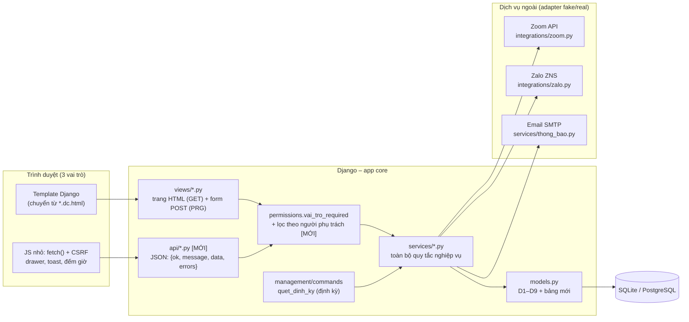
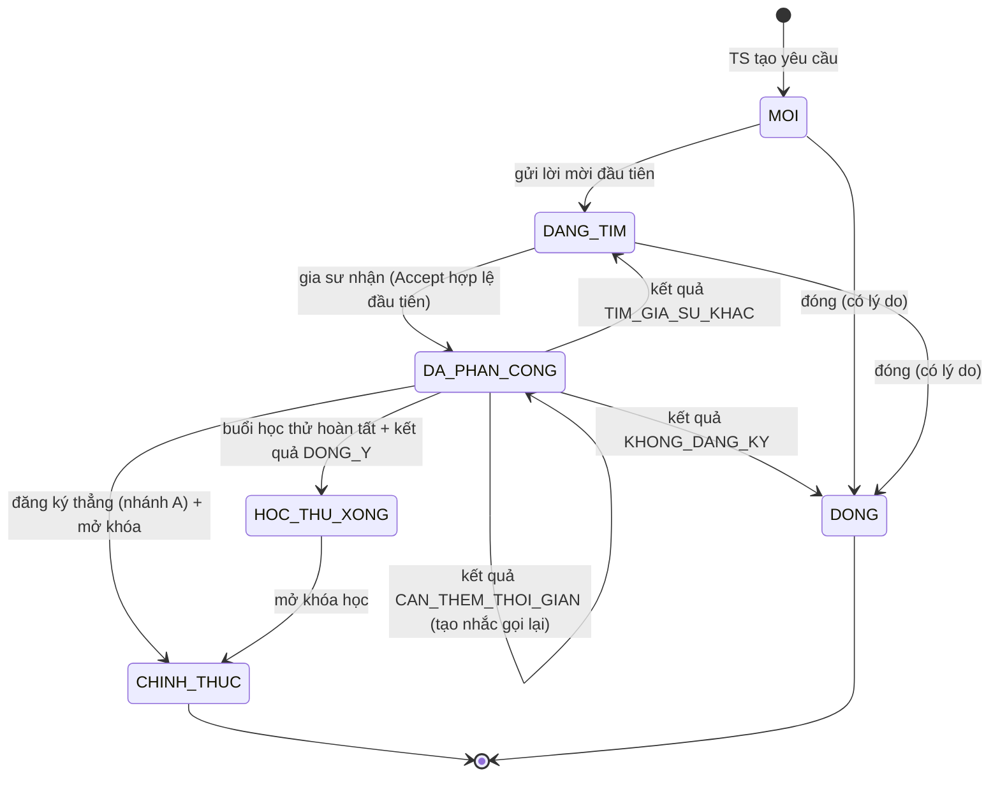
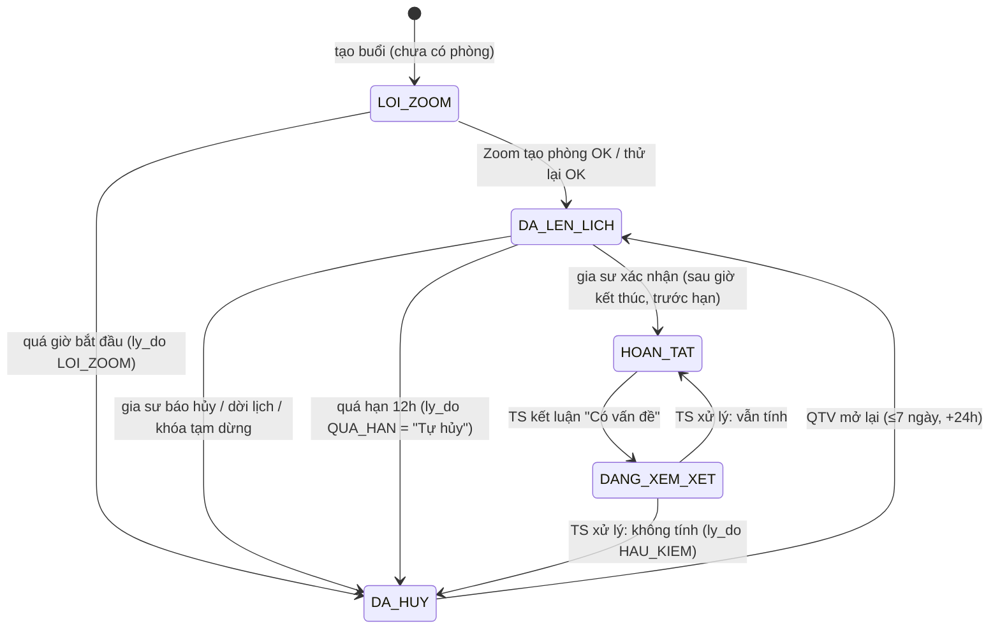
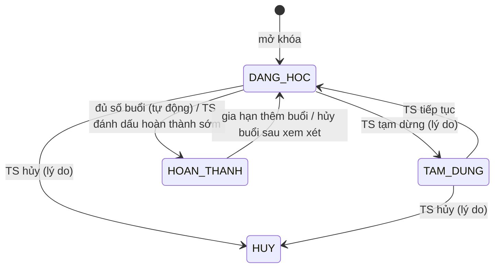

# 01 · Kiến trúc và quy ước

## 1. Kiến trúc tổng thể

Giữ nguyên stack đã chốt: **Django 6 (server-render) + SQLite (MVP) + Bootstrap 5.3 + `static/css/app.css`**. UI mới không đổi kiến trúc, chỉ thêm một lớp **API JSON nhỏ** cho các thao tác tương tác (drawer, tick hàng loạt, tự lưu nháp, Ctrl+K, sao chép, đồng hồ đếm ngược).



**Nguyên tắc chia tầng (giữ như code cũ):**

| Tầng | Được làm | Không được làm |
|---|---|---|
| Template / JS | Hiển thị, kiểm tra nhập ở phía client cho nhanh, gọi API | Tự quyết quy tắc nghiệp vụ (hạn 24h, 12h, 67%…) – chỉ hiển thị giá trị server trả về |
| View / API | Kiểm tra vai trò, lấy đối tượng (`get_object_or_404`), gọi **một** hàm service, chuyển `ValidationError` thành thông báo | Viết SQL nghiệp vụ, đổi trạng thái trực tiếp |
| Service | Mọi quy tắc, transaction, cập nhật có điều kiện, ghi nhật ký, gửi email/Zalo/Zoom | Đọc `request` |
| Model | Ràng buộc DB (`CheckConstraint`, `UniqueConstraint`), thuộc tính suy ra (`ma`, `ket_thuc`, `cho_xac_nhan`) | Gọi dịch vụ ngoài |

## 2. Quy ước bắt buộc giữ (đã có trong code, mọi luồng mới phải làm theo)

1. **Cập nhật có điều kiện chống chạy đua** – đổi trạng thái bằng `Model.objects.filter(pk=…, trang_thai=<trạng thái mong đợi>).update(...)`; nếu `n == 0` → `ValidationError("… vừa thay đổi, vui lòng tải lại")`. Đây là cách "Accept hợp lệ đầu tiên thắng" chạy được cả trên SQLite.
2. **`transaction.atomic()`** cho mọi thao tác ghi nhiều bảng. Việc gọi Zoom xóa phòng đặt trong `transaction.on_commit()`.
3. **Ghi nhật ký** bằng `ghi_nhat_ky(nguoi, hanh_dong, doi_tuong, chi_tiet)` cho mọi thao tác thay đổi dữ liệu. Thao tác của Admin **bắt buộc có lý do** (`_ly_do()` trong `ngoai_le.py`).
4. **Lỗi dịch vụ ngoài không làm hỏng nghiệp vụ chính**: email/Zalo lỗi → ghi `NhatKyGuiTin(thanh_cong=False)`; Zoom lỗi khi tạo → buổi ở `LOI_ZOOM`, thử lại được.
5. **Quyền riêng tư theo vai trò**: gia sư không bao giờ thấy SĐT phụ huynh, học phí; Tuyển sinh không thấy host key Zoom.
6. **Tham số nghiệp vụ** đọc từ `settings.NGHIEP_VU`, không viết cứng (24h, 12h, 3h, 7 ngày, 24h mở lại, 67%, số phòng Zoom, 30 ngày bản ghi). Tham số mới thêm ở `02` mục 6.
7. **Mã hiển thị** suy từ khóa chính: `YC-0001`, `KH-0001`, `BH-00001`. Không lưu cột mã riêng (trừ `KhoaHoc.ma_lop` cho link lớp cố định).

## 3. Quy ước API JSON mới

- Đường dẫn: `/api/<nhóm>/<hành-động>/`, chỉ `POST` cho thao tác ghi, `GET` cho đọc. Dùng session login + CSRF token như form thường.
- Trả về:

```json
{ "ok": true, "message": "Đã gửi 3 lời mời (hiệu lực 24 giờ).", "data": { … }, "errors": {} }
```

- Lỗi nghiệp vụ (`ValidationError`) → HTTP 200 với `ok: false` và `errors` theo field (để hiện lỗi cạnh ô nhập như UI). Lỗi quyền → 403. Đối tượng không có → 404. Lỗi hệ thống → 500 và **ghi `SuCoHeThong`** (xem SD-34).
- Mỗi view API gọi đúng hàm service như view HTML, để hai đường dùng chung quy tắc.
- Mọi trang vẫn chạy được khi tắt JS (form POST + redirect + `messages`) – giữ test cũ.

## 4. Ký hiệu trong sơ đồ tuần tự

| Participant | Ý nghĩa |
|---|---|
| `actor GS / TS / QTV` | Gia sư / Tuyển sinh / Quản trị viên |
| `UI` | Màn hình (tên file `.dc.html` ghi trong tiêu đề SD) |
| `V` | View HTML hoặc API (ghi URL) |
| `S` | Service (ghi tên hàm) |
| `DB` | Database (ghi bảng) |
| `ZM` / `ZL` / `EM` | Zoom API / Zalo ZNS / Email |
| `SCH` | Tác vụ định kỳ `quet_dinh_ky` |

Khối `alt` = các nhánh tình huống; `opt` = bước tùy chọn; `critical` = đoạn trong transaction; `Note` = quy tắc nghiệp vụ.

## 5. Vòng đời các đối tượng chính (sau khi sửa)

### 5.1 Yêu cầu học tập (`YeuCauHocTap`)



Nhãn hiển thị mới: `MOI` "Mới" · `DANG_TIM` "Đang mời gia sư" · `DA_PHAN_CONG` "Đã có gia sư" · `HOC_THU_XONG` "Học thử" · `CHINH_THUC` "Đã mở khóa" · `DONG` "Đã đóng".

### 5.2 Buổi học (`BuoiHoc`)



Trạng thái hiển thị (suy ra, không lưu): **Sắp diễn ra** (`DA_LEN_LICH`, chưa tới giờ) · **Đang học** (trong giờ) · **Chờ xác nhận** (`cho_xac_nhan`) · **Sắp tự hủy** (còn < 3h tới hạn) · **Tự hủy** (`DA_HUY` + `QUA_HAN`) · **Lỗi Zoom** (`LOI_ZOOM`).

### 5.3 Khóa học (`KhoaHoc`)



"Sắp hết buổi" = `DANG_HOC` và `so_buoi_con_lai ≤ NGUONG_SAP_HET_BUOI` (mặc định 2) – suy ra, không lưu.

### 5.4 Lời mời (`LoiMoi`)

`CHO` "Đang chờ" → `ACCEPTED` "Đã nhận" | `REJECTED` "Đã từ chối" | `VOIDED` "Đã vô hiệu" | `HET_HAN` "Hết hạn".
