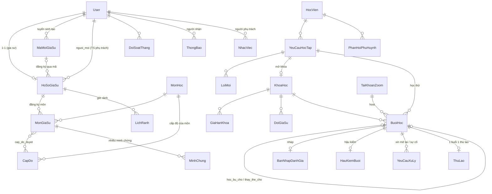

# 02 · Thay đổi Database

Căn cứ: `Code/core/models.py` (D1–D9). Mục tiêu: **thêm tối thiểu**, giữ tên model/trường tiếng Việt không dấu như cũ, không đổi giá trị lưu trong DB của các `TextChoices` (chỉ đổi **nhãn hiển thị**) để test cũ và dữ liệu seed vẫn chạy.

## 1. Tổng quan thay đổi

| Kho | Model | Loại | Tóm tắt |
|---|---|---|---|
| D1 | `User` | [SỬA] | + `phai_doi_mat_khau`, `ly_do_khoa`, `khoa_luc`; đổi nhãn vai trò |
| D1 | `MaMoiGiaSu` | [MỚI] | Link mời gia sư đăng ký của từng Tuyển sinh |
| D2 | `MonHoc` | [SỬA] | + thông tin bài test (link, số câu, thời gian, điểm đạt), `dang_mo` |
| D2 | `CapDo` | [MỚI] | Danh mục cấp độ do trung tâm cấu hình |
| D2 | `HoSoGiaSu` | [SỬA] | + `nguoi_moi` (Tuyển sinh phụ trách), `so_lop_toi_da`, `tam_nghi_den`, `muc_tieu_buoi_thang`, `truong_hoc` |
| D2 | `MonGiaSu` | [SỬA] | + `cap_do_duyet` (M2M `CapDo`), `diem_test`, `anh_ket_qua_test`, `link_ket_qua_test`, `ly_do_dang_ky`, trạng thái `DA_RUT` |
| D2 | `MinhChung` | [MỚI] | Nhiều minh chứng / môn (tệp hoặc link) |
| D2 | `LichRanh` | [SỬA] | + `khung` (SANG/CHIEU/TOI_SOM/TOI) để khớp lưới giờ trên UI |
| D3 | `HocVien` | [SỬA] | + `gioi_tinh`, `truong`, `tuyen_sinh_phu_trach` |
| D3 | `PhanHoiPhuHuynh` | [MỚI] | Phản hồi / phản ánh của phụ huynh (TS nhập) |
| D4 | `YeuCauHocTap` | [SỬA] | + `khung_mong_muon` (JSON), đổi `KetQuaHocThu`, + `nhac_goi_lai_luc`, `dang_ky_thang` |
| D5 | `LoiMoi` | [SỬA] | + `diem_khop`, `chi_tiet_khop` (JSON), `ghi_chu_gia_su`, `cam_ket` |
| D6 | `KhoaHoc` | [SỬA] | + `ma_lop` (link lớp cố định), `lich_co_dinh` (JSON), `zalo_nhom`, `ghi_chu_phu_huynh`, `tuyen_sinh_phu_trach` |
| D6 | `GiaHanKhoa` | [MỚI] | Lịch sử gia hạn / sửa số buổi |
| D6 | `DoiGiaSu` | [SỬA] | + `gia_su_moi` bắt buộc khi đề xuất, `thu_lao_moi`, `gia_su_moi_dong_y`, `so_buoi_chuyen` |
| D7 | `BuoiHoc` | [SỬA] | + `tai_khoan_zoom`, `zoom_host_key`(qua tài khoản), `hoc_bu_cho`, `muc_tiep_thu`, `bai_tap_ve_nha`, `ghi_chu_tuyen_sinh`, `gui_zalo_phu_huynh`, `ly_do_huy_ghi_chu` |
| D7 | `TaiKhoanZoom` | [MỚI] | Nhóm tài khoản host Zoom (host key) |
| D7 | `BanNhapDanhGia` | [MỚI] | Tự lưu nháp phiếu đánh giá (khôi phục khi lỗi) |
| D7 | `HauKiemBuoi` | [MỚI] | Kết quả 5 tiêu chí + kết luận của Tuyển sinh |
| D7 | `YeuCauXuLy` | [MỚI] | Gia sư xin mở lại / báo lỗi hệ thống / sự cố Zoom → trang Cần xem xét |
| D8 | `ThuLao` | giữ | (đổi nhãn) |
| D8 | `DoiSoatThang` | [SỬA] | + trạng thái `DA_CHI_TRA`, `chi_tra_boi`, `chi_tra_luc` |
| D9 | `NhatKy` | [SỬA] | + `loai_doi_tuong`, `ma_doi_tuong`, `gia_tri_cu`, `gia_tri_moi` (JSON), `ip` |
| D9 | `ThongBao` | [MỚI] | Thông báo trong ứng dụng (chuông) |
| D9 | `NhacViec` | [MỚI] | Nhắc việc có hạn (gọi lại phụ huynh, hạn lời mời…) |
| D9 | `SuCoHeThong` | [MỚI] | Lỗi 500 tự ghi lại khi người dùng thao tác |

## 2. ERD (phần thay đổi và quan hệ chính)

## 3. Đặc tả từng thay đổi

> Ký hiệu kiểu: `FK→X` = ForeignKey; `null` = null=True, blank=True. Giá trị mặc định ghi sau dấu `=`.

### 3.1 D1 – Tài khoản

**`User` [SỬA]**

| Trường | Kiểu | Ghi chú |
|---|---|---|
| `phai_doi_mat_khau` | Bool = False | True khi Admin tạo tài khoản / đặt lại mật khẩu → sau đăng nhập bắt đổi (SD-02) |
| `ly_do_khoa` | Char(300), blank | Bắt buộc khi khóa |
| `khoa_luc` | DateTime null | |

Nhãn vai trò: `ADMIN` "Quản trị viên" · `TUYEN_SINH` "Tuyển sinh" · `GIA_SU` "Gia sư". Trạng thái tài khoản hiển thị: **Hoạt động** (`is_active` và `last_login`) · **Chưa đăng nhập** (`last_login is null`) · **Đã khóa** (`not is_active`).

**`MaMoiGiaSu` [MỚI]** – link "Mời gia sư đăng ký" trên trang Tuyển sinh › Gia sư.

| Trường | Kiểu | Ghi chú |
|---|---|---|
| `ma` | Char(12) unique | Sinh ngẫu nhiên, dùng trong `/dang-ky-gia-su/<ma>/` |
| `tuyen_sinh` | FK→User | Người mời = người chịu trách nhiệm hậu kiểm |
| `het_han_luc` | DateTime null | null = không hết hạn |
| `dang_mo` | Bool = True | |
| `tao_luc` | DateTime auto | |

### 3.2 D2 – Hồ sơ gia sư, môn, cấp độ

**`MonHoc` [SỬA]** (Admin cấu hình, không viết cứng trong code)

| Trường | Kiểu | Ghi chú |
|---|---|---|
| `bai_test_url` | URL(500), blank | Link bài test năng lực của môn (`https://giasuonline.vn/bai-test/<slug>`) |
| `bai_test_so_cau` | PositiveInt null | |
| `bai_test_phut` | PositiveInt null | |
| `diem_dat` | Decimal(4,2) null | Ngưỡng đạt (VD 7,0/10) |
| `dang_mo` | Bool = True | Ẩn môn khỏi danh mục đăng ký |

**`CapDo` [MỚI]**

| Trường | Kiểu | Ghi chú |
|---|---|---|
| `mon_hoc` | FK→MonHoc null | null = cấp độ dùng chung |
| `ten` | Char(80) | "Lớp 6–7", "Luyện thi vào 10", "IELTS 6.5–7.5" |
| `thu_tu` | PositiveInt = 0 | |
| `dang_mo` | Bool = True | |

**`HoSoGiaSu` [SỬA]**

| Trường | Kiểu | Ghi chú |
|---|---|---|
| `nguoi_moi` | FK→User null (TUYEN_SINH) | Gia sư do ai mời → người hậu kiểm. Admin gán lại được |
| `ma_moi` | FK→MaMoiGiaSu null | |
| `so_lop_toi_da` | PositiveInt = 4 | Cột "Lớp đang dạy x/y"; trạng thái **Kín lịch** khi số khóa `DANG_HOC` ≥ giá trị này |
| `tam_nghi_den` | Date null | **Tạm nghỉ** khi ≥ hôm nay: không đề xuất, không nhận lời mời |
| `muc_tieu_buoi_thang` | PositiveInt = 20 | Vòng tiến độ trang chủ gia sư |
| `truong_hoc` | Char(200), blank | "SV năm 4 Sư phạm Toán · ĐHSP Đà Nẵng" |

Giữ `trang_thai` (`CHO_DUYET` "Chờ duyệt hồ sơ" · `HOAT_DONG` "Đang hoạt động" · `TAM_NGUNG` "Tạm ngừng").

**`MonGiaSu` [SỬA]**

| Trường | Kiểu | Ghi chú |
|---|---|---|
| `cap_do_duyet` | M2M→CapDo | Thay dần `cap_do` (Char). Giữ `cap_do` làm chuỗi hiển thị để không vỡ test |
| `diem_test` | Decimal(4,2) null | Gia sư tự khai, Admin đối chiếu |
| `anh_ket_qua_test` | ImageField null | `upload_to="minh_chung/test/"` |
| `link_ket_qua_test` | URL(500), blank | Thay cho ảnh nếu gia sư dán link |
| `ly_do_dang_ky` | Text, blank | "Kinh nghiệm gia sư mô tả" |
| `gui_luc` | DateTime null | |
| trạng thái | + `DA_RUT` "Đã rút" | Gia sư rút môn đang chờ (thay vì xóa bản ghi như cũ) |

Ràng buộc: giữ `UniqueConstraint(ho_so, mon_hoc)`; đăng ký lại môn `TU_CHOI`/`DA_RUT` = cập nhật bản ghi cũ về `CHO_DUYET` ("Gửi lại").

**`MinhChung` [MỚI]**

| Trường | Kiểu | Ghi chú |
|---|---|---|
| `mon_gia_su` | FK→MonGiaSu null | null = minh chứng chung của hồ sơ |
| `ho_so` | FK→HoSoGiaSu | |
| `loai` | Choice | `BANG_CAP` Bằng cấp · `BANG_DIEM` Bảng điểm · `THE_SV` Thẻ sinh viên · `CHUNG_CHI` Chứng chỉ · `GIAY_KHEN` Giấy khen · `KHAC` Khác |
| `kieu` | Choice | `TEP` / `LINK` |
| `tep` | FileField null | pdf/jpg/png ≤ 5 MB |
| `url` | URL(500), blank | chỉ chấp nhận `https://` |
| `mo_ta` | Char(200), blank | "Chứng chỉ IELTS 8.0 còn hạn 03/2027" |
| `tao_luc` | DateTime auto | |

Ràng buộc: `CheckConstraint`: (`kieu=TEP` và `tep` có) hoặc (`kieu=LINK` và `url` có).

**`LichRanh` [SỬA]** – thêm `khung` (Choice `SANG` 08–11 · `CHIEU` 14–17 · `TOI_SOM` 17:30–19 · `TOI` 19–21) để lưới giờ rảnh trên UI ghi thẳng vào DB. Giữ `tu_gio/den_gio` (điền tự động theo khung) để so trùng giờ như cũ. Thêm `UniqueConstraint(ho_so, thu, khung)`.

### 3.3 D3 – Học viên

**`HocVien` [SỬA]**: + `gioi_tinh` (Choice Nam/Nữ, blank), `truong` (Char 200, blank), `tuyen_sinh_phu_trach` (FK→User null; mặc định = `tao_boi`). Giữ nguyên chuẩn hóa `sdt_phu_huynh` dạng `84…`.

**`PhanHoiPhuHuynh` [MỚI]** – phục vụ "Phụ huynh phản ánh" (trang Hậu kiểm) và "Đánh giá PH" (trang Gia sư).

| Trường | Kiểu | Ghi chú |
|---|---|---|
| `hoc_vien` | FK→HocVien | |
| `khoa_hoc` | FK→KhoaHoc null | |
| `buoi_hoc` | FK→BuoiHoc null | |
| `gia_su` | FK→User null | |
| `diem` | PositiveSmallInt null (1–5) | |
| `noi_dung` | Text | |
| `kenh` | Choice | Gọi điện / Zalo / Khác |
| `tao_boi` | FK→User | Tuyển sinh |
| `tao_luc` | DateTime auto | |

### 3.4 D4 – Yêu cầu học tập

**`YeuCauHocTap` [SỬA]**

| Trường | Kiểu | Ghi chú |
|---|---|---|
| `khung_mong_muon` | JSON = [] | Danh sách `"<thu>-<khung>"`, VD `["1-TOI","3-TOI","5-SANG"]`. Giữ `thu_mong_muon` (suy từ khung) cho code đề xuất cũ |
| `lich_mong_muon` | (giữ) | Chuỗi hiển thị sinh tự động "T3, T5 19:00–21:00 · T7 08:00–11:00" |
| `dang_ky_thang` | Bool = False | Đánh dấu nhánh A (đăng ký chính thức luôn) |
| `nhac_goi_lai_luc` | DateTime null | Khi kết quả `CAN_THEM_THOI_GIAN` (+2 ngày) |
| `ghi_chu` | Text, blank | "Học viên hơi nhút nhát…" (gia sư thấy trong lời mời) |
| `cap_do` | FK→CapDo null | Cấp độ chọn từ danh mục (giữ `trinh_do` chuỗi để hiển thị/tương thích) – dùng chấm "Đúng cấp độ" |
| `thu_lao_du_kien` | PositiveInt null | Thù lao/buổi hiện trong lời mời; trống = "Thỏa thuận khi mở khóa". Gia sư **không** thấy học phí |

`KetQuaHocThu` mới (giá trị lưu):

| Giá trị | Nhãn | Hệ quả |
|---|---|---|
| `DONG_Y` (thay `TIEP_TUC`) | Đồng ý đăng ký | → `HOC_THU_XONG`, mở khóa được |
| `CAN_THEM_THOI_GIAN` [MỚI] | Cần thêm thời gian | Giữ `DA_PHAN_CONG`, tạo `NhacViec` gọi lại sau 2 ngày |
| `TIM_GIA_SU_KHAC` | Tìm gia sư khác | → `DANG_TIM`, gỡ gia sư |
| `KHONG_DANG_KY` (thay `DUNG`) | Không đăng ký | → `DONG`, lý do "Không đăng ký sau học thử" |

Migration dữ liệu: `TIEP_TUC→DONG_Y`, `DUNG→KHONG_DANG_KY`.

### 3.5 D5 – Lời mời

**`LoiMoi` [SỬA]**: + `diem_khop` (PositiveSmallInt null, 0–100), `chi_tiet_khop` (JSON: `{"dung_mon":true,"dung_cap_do":true,"trung_gio":"3/3","dang_nhan_lop":true}`), `ghi_chu_gia_su` (Char 300, blank – lời nhắn khi nhận lớp), `cam_ket` (Bool = False – tick "Tôi cam kết dạy đúng lịch").

Lý do từ chối dạng danh mục (giữ cột `ly_do_tu_choi` Char): "Không trùng giờ rảnh" · "Đã đủ số lớp đang dạy" · "Không hợp cấp độ" · "Lý do khác: …".

### 3.6 D6 – Khóa học

**`KhoaHoc` [SỬA]**

| Trường | Kiểu | Ghi chú |
|---|---|---|
| `ma_lop` | Char(20) unique null | Mặc định = `KH-0005`; link cố định `/lop/<ma_lop>/` |
| `lich_co_dinh` | JSON = [] | `[{"thu":2,"gio":"20:00"},{"thu":5,"gio":"08:00"}]` – gợi ý khi tạo buổi |
| `zalo_nhom` | Char(150), blank | "IELTS Gia Bảo – Cô Lan" |
| `ghi_chu_phu_huynh` | Text, blank | "Ưu tiên Writing…" (gia sư thấy) |
| `tuyen_sinh_phu_trach` | FK→User null | Mặc định = `tao_boi` |
| `hoan_thanh_luc` | DateTime null | |

Chuyển trạng thái mới: `DANG_HOC → HOAN_THANH` thủ công ("Đánh dấu hoàn thành" – bắt buộc lý do).

**`GiaHanKhoa` [MỚI]**

| Trường | Kiểu | Ghi chú |
|---|---|---|
| `khoa_hoc` | FK→KhoaHoc | |
| `loai` | Choice | `GIA_HAN` (phụ huynh mua thêm) / `SUA_NHAP_NHAM` (Admin sửa) |
| `so_buoi_cu`, `so_buoi_moi` | PositiveInt | |
| `hoc_phi_moi_buoi` | PositiveInt null | Nếu đổi học phí khi gia hạn |
| `ly_do` | Char(300) | bắt buộc |
| `tao_boi` / `tao_luc` | | |

**`DoiGiaSu` [SỬA]**: `gia_su_moi` **bắt buộc khi tạo** (UI chọn sẵn gia sư mới), + `thu_lao_moi` (PositiveInt), `gia_su_moi_dong_y` (Bool – TS xác nhận đã hỏi qua Zalo), `so_buoi_chuyen` (PositiveInt – số buổi đã xếp được chuyển). Giữ `CHO_DUYET` / `DA_THUC_HIEN` / `TU_CHOI`.

### 3.7 D7 – Buổi học, Zoom, hậu kiểm

**`TaiKhoanZoom` [MỚI]** (hướng nâng cấp đã ghi trong `docs/phan_vai.md`)

| Trường | Kiểu | Ghi chú |
|---|---|---|
| `email_host` | Email unique | |
| `host_key` | Char(10) | **Chỉ gia sư của buổi thấy** (che mặc định `••••••`) |
| `dang_bat` | Bool = True | |
| `ghi_chu` | Char(200) | |

`SO_PHONG_ZOOM_DONG_THOI` = số `TaiKhoanZoom.dang_bat`. Không có bản ghi nào → dùng `ZOOM_HOST_EMAIL_MAC_DINH` như cũ.

**`BuoiHoc` [SỬA]**

| Trường | Kiểu | Ghi chú |
|---|---|---|
| `tai_khoan_zoom` | FK→TaiKhoanZoom null | Host được cấp khi tạo phòng |
| `hoc_bu_cho` | OneToOne→self null | Buổi bị hủy (gia sư/học viên nghỉ) được bù. Khác `thay_the_cho` (dời lịch) |
| `muc_tiep_thu` | Choice | `TOT` "Tiếp thu tốt" · `KHA` "Tiếp thu cơ bản" · `CAN_HO_TRO` "Cần hỗ trợ thêm" (đổi tên từ `xep_loai`, giữ giá trị) |
| `bai_tap_ve_nha` | Text, blank | thay `dan_do_buoi_sau` (giữ cột cũ, đổi `verbose_name`) |
| `ghi_chu_tuyen_sinh` | Text, blank | Chỉ Tuyển sinh/Admin đọc |
| `gui_zalo_phu_huynh` | Bool = True | Gia sư tắt được nếu không muốn gửi ZNS tự động |
| `ly_do_huy_ghi_chu` | Char(300), blank | Tách khỏi `kiem_tra_ghi_chu` (code cũ đang dùng chung) |
| `phong_mo_luc` / `phong_dong_luc` | DateTime null | Ghi khi tác vụ định kỳ mở/đóng phòng (SD-14) |
| `ket_thuc_luc` | DateTime, index | = `bat_dau + thoi_luong_phut`, tính trong `save()`; dùng lọc "Chờ xác nhận" và kiểm tra trùng giờ bằng SQL (mục 4) |

Ánh xạ ô trên phiếu đánh giá UI → cột: "Nội dung đã dạy" → `noi_dung` · "Mức tiếp thu" → `xep_loai`/`muc_tiep_thu` · "Nhận xét tiến độ / gửi phụ huynh" → `danh_gia` · "Bài tập về nhà" → `dan_do_buoi_sau` · "Ghi chú cho Tuyển sinh" → `ghi_chu_tuyen_sinh`.

**`BanNhapDanhGia` [MỚI]**

| Trường | Kiểu | Ghi chú |
|---|---|---|
| `buoi_hoc` | OneToOne→BuoiHoc | |
| `du_lieu` | JSON | các ô phiếu đánh giá |
| `luu_luc` | DateTime auto_now | UI: "Đã lưu nháp 21:04" |

**`HauKiemBuoi` [MỚI]** (thay việc Admin xem xét bằng Tuyển sinh kết luận)

| Trường | Kiểu | Ghi chú |
|---|---|---|
| `buoi_hoc` | OneToOne→BuoiHoc | |
| `nguoi_phu_trach` | FK→User | = `HoSoGiaSu.nguoi_moi` của gia sư lúc chấm |
| `tre_phut` | SmallInt null | Gia sư vào trễ (phút) – tiêu chí 1 (≤ 5) |
| `ty_le_gia_su` | PositiveSmallInt null | % thời lượng – tiêu chí 2 (≥ 67) |
| `ty_le_hoc_vien` | PositiveSmallInt null | tiêu chí 3 (≥ 67) |
| `do_dai_nhan_xet` | PositiveSmallInt | tiêu chí 4 (≥ 30 ký tự) |
| `da_gui_zalo` | Bool | tiêu chí 5 |
| `so_canh_bao` | PositiveSmallInt | số tiêu chí không đạt |
| `ket_luan` | Choice | `CHUA_KIEM_TRA` · `HOP_LE` · `CO_VAN_DE` · `DA_XU_LY_TINH` · `DA_XU_LY_KHONG_TINH` |
| `ly_do` | Choice blank | "Vào trễ", "Tham gia thiếu giờ", "Nhận xét sơ sài", "Chưa gửi Zalo", "Phụ huynh phản ánh", "Khác" |
| `ghi_chu` | Text blank | |
| `kiem_luc` / `kiem_boi` | | |
| `hang_loat` | Bool = False | Kết luận bằng "Duyệt nhanh" |

`BuoiHoc.kiem_tra` giữ làm trường tóm tắt, đồng bộ: `HOP_LE`/`DA_XU_LY_*` → `HOP_LE`/`DA_XU_LY`; `CO_VAN_DE` → `CO_VAN_DE`.

**`YeuCauXuLy` [MỚI]** – nguồn dữ liệu cho trang **Cần xem xét** (ngoài đổi gia sư, hồ sơ, môn đã có bảng riêng).

| Trường | Kiểu | Ghi chú |
|---|---|---|
| `loai` | Choice | `MO_LAI` (gia sư xin mở lại buổi tự hủy) · `LOI_HE_THONG` (lỗi 500 khi thao tác) · `SU_CO_ZOOM` (không tạo/mở được phòng) |
| `buoi_hoc` | FK→BuoiHoc null | |
| `nguoi_gui` | FK→User | |
| `noi_dung` | Text | Lời gia sư: "Tối hôm đó em bị sốt…" |
| `minh_chung_url` | URL blank | |
| `su_co` | FK→SuCoHeThong null | |
| `trang_thai` | Choice | `CHO_XU_LY` · `DA_XU_LY` · `TU_CHOI` · `CHUYEN_KY_THUAT` |
| `han_xu_ly` | DateTime null | = hạn mở lại 7 ngày |
| `xu_ly_boi` / `xu_ly_luc` / `ket_qua` | | `ket_qua` bắt buộc (lý do Admin) |

### 3.8 D8 – Thù lao

Giữ `ThuLao`, `DieuChinhThuLao`. **`DoiSoatThang` [SỬA]**: + `DA_CHI_TRA` "Đã chi trả", `chi_tra_boi`, `chi_tra_luc`, `chung_tu` (Char 200 – số UNC/ghi chú chuyển khoản). Tháng chưa có bản ghi = "Đang mở" (như cũ).

### 3.9 D9 – Nhật ký, thông báo

**`NhatKy` [SỬA]**: + `loai_doi_tuong` (Choice: Yêu cầu, Lời mời, Khóa học, Buổi học, Hồ sơ, Môn, Thù lao, Tài khoản, Hệ thống) · `ma_doi_tuong` (Char 30, index – để lọc/tìm `BH-00398`) · `gia_tri_cu`, `gia_tri_moi` (JSON null – bảng "Trước / Sau" trên trang Nhật ký) · `ip` (GenericIP null). Hàm `ghi_nhat_ky()` thêm tham số tùy chọn, không phá lời gọi cũ.

**`ThongBao` [MỚI]**: `nguoi_nhan` FK→User · `loai` (Choice) · `tieu_de` · `noi_dung` · `url` · `da_doc` Bool · `tao_luc`. Tạo cùng chỗ đang gọi `gui_email()` (thêm hàm `thong_bao(user, …)` trong `services/thong_bao.py`).

**`NhacViec` [MỚI]**: `nguoi_phu_trach` FK→User · `loai` (`GOI_LAI_PHU_HUYNH`, `HOI_GIA_HAN`, …) · `doi_tuong` (GenericFK hoặc `yeu_cau`/`khoa_hoc` FK null) · `han_luc` · `xong_luc` null. Hiện trong lịch và "Việc cần làm" của trang chủ Tuyển sinh.

**`SuCoHeThong` [MỚI]**: `nguoi_dung` FK null · `duong_dan` · `phuong_thuc` · `ma_loi` (500…) · `chi_tiet` (traceback rút gọn) · `du_lieu_form` (JSON, đã bỏ mật khẩu) · `tao_luc`. Ghi bằng middleware bắt exception (SD-34).

## 4. Vì sao KHÔNG thêm trạng thái `CHO_XAC_NHAN` / `TU_HUY` vào DB (Q4)

- Code cũ dùng `DA_LEN_LICH` cho cả "sắp học" lẫn "chờ xác nhận", và `TRANG_THAI_CHIEM_CHO`, `xac_nhan_hoan_tat`, `quet_han`, `mo_lai`, `doi_trang_thai_khoa`, 15 file test đều dựa vào điều này. Thêm trạng thái thật buộc một tác vụ phải **đổi trạng thái đúng lúc buổi kết thúc** → nếu tác vụ định kỳ trễ 15 phút, UI hiển thị sai và xác nhận bị chặn.
- Suy ra theo thời gian (`ket_thuc <= now`) luôn đúng, không cần tác vụ. UI chỉ cần nhãn: thêm thuộc tính `BuoiHoc.trang_thai_hien_thi` trả về `("cho_xac_nhan", "Chờ xác nhận")`, `("tu_huy", "Tự hủy")`, `("sap_tu_huy", "Sắp tự hủy")`…
- Để lọc nhanh danh sách, dùng `Q(trang_thai=DA_LEN_LICH, bat_dau__lte=now - thoi_luong)` hoặc thêm cột phụ `ket_thuc_luc` (DateTime, tính khi lưu) + index. **Khuyến nghị thêm `ket_thuc_luc`** – giúp truy vấn trùng giờ khỏi lọc bằng Python như `_buoi_trung_gio()` hiện tại.

## 5. Đổi nhãn hiển thị (không đổi giá trị lưu)

| Model.TrangThai | Giá trị | Nhãn cũ | Nhãn mới (theo UI) |
|---|---|---|---|
| YeuCauHocTap | DANG_TIM | Đang tìm gia sư | Đang mời gia sư |
| | DA_PHAN_CONG | Đã phân công | Đã có gia sư |
| | HOC_THU_XONG | Học thử xong | Học thử |
| | CHINH_THUC | Đã mở khóa chính thức | Đã mở khóa |
| LoiMoi | CHO / REJECTED / VOIDED | Chờ phản hồi / Từ chối / Vô hiệu (…) | Đang chờ / Đã từ chối / Đã vô hiệu |
| BuoiHoc | LOI_ZOOM | Lỗi tạo Zoom | Lỗi Zoom |
| BuoiHoc.XepLoai | TOT / KHA / CAN_HO_TRO | (câu dài) | Tiếp thu tốt / Tiếp thu cơ bản / Cần hỗ trợ thêm |
| MonGiaSu | TU_CHOI | Từ chối | Bị từ chối |
| ThuLao | TAM_GIU | Tạm giữ (đang xem xét) | Tạm giữ |
| DoiSoatThang | DA_KIEM_TRA | NVTS đã kiểm tra | Tuyển sinh đã kiểm tra |
| User.VaiTro | ADMIN / TUYEN_SINH | Admin / Nhân viên tuyển sinh | Quản trị viên / Tuyển sinh |

> Test cũ có so khớp chuỗi nhãn (VD `assertContains(r, "Đang tìm gia sư")`) phải cập nhật cùng lúc.

## 6. Tham số nghiệp vụ mới (`settings.NGHIEP_VU`)

| Khóa | Mặc định | Dùng ở |
|---|---|---|
| `MO_PHONG_TRUOC_PHUT` | 10 | `/lop/<ma>/` cho vào trước giờ học; tác vụ mở phòng |
| `DONG_PHONG_SAU_PHUT` | 5 | Tác vụ kết thúc phòng Zoom sau giờ kết thúc |
| `GIO_KET_THUC_MUON_NHAT` | "22:00" | Tạo buổi: buổi phải kết thúc trước giờ này |
| `NGUONG_SAP_HET_BUOI` | 2 | "Sắp hết buổi" |
| `TRE_TOI_DA_PHUT` | 5 | Hậu kiểm tiêu chí 1 |
| `DO_DAI_NHAN_XET_TOI_THIEU` | 30 | Hậu kiểm tiêu chí 4 + kiểm tra form đánh giá |
| `NGAY_NHAC_GOI_LAI` | 2 | Kết quả học thử "Cần thêm thời gian" |
| `GIAY_HOAN_TAC` | 6 | Toast "Hoàn tác" (đóng yêu cầu, khóa tài khoản…) |
| `SO_BUOI_TAO_TOI_DA_MOT_LAN` | 8 | Tạo nhiều buổi lặp tuần |
| `CHO_ZOOM_TONG_HOP_PHUT` | 30 | Đã có trong code (`_cho_zoom_tong_hop`), đưa ra tham số |

## 7. Thứ tự migration (chia đợt để test cũ luôn xanh)

| Đợt | Migration | Kiểm tra |
|---|---|---|
| 1 | Đổi nhãn `TextChoices` (mục 5) + cập nhật test so chuỗi | `manage.py test core` xanh |
| 2 | Thêm cột **có giá trị mặc định / null** vào model cũ (User, HoSoGiaSu, MonGiaSu, LichRanh, HocVien, YeuCauHocTap, LoiMoi, KhoaHoc, BuoiHoc, DoiSoatThang, NhatKy). `RunPython`: `KhoaHoc.ma_lop = ma`, `HoSoGiaSu.nguoi_moi = tao_boi của lời mời đầu tiên hoặc NULL`, `KhoaHoc/HocVien.tuyen_sinh_phu_trach = tao_boi`, `BuoiHoc.ket_thuc_luc`, `LichRanh.khung` từ giờ | Test cũ xanh |
| 3 | Đổi giá trị `KetQuaHocThu` (`TIEP_TUC→DONG_Y`, `DUNG→KHONG_DANG_KY`) bằng `RunPython`, sửa `khoa_hoc.py` + test | |
| 4 | Bảng mới không phụ thuộc: `CapDo`, `MinhChung`, `MaMoiGiaSu`, `TaiKhoanZoom`, `ThongBao`, `NhacViec`, `SuCoHeThong`, `PhanHoiPhuHuynh`, `GiaHanKhoa` | Test mới cho từng service |
| 5 | Bảng phụ thuộc buổi học: `BanNhapDanhGia`, `HauKiemBuoi`, `YeuCauXuLy`; `RunPython` tạo `HauKiemBuoi` cho buổi `HOAN_TAT` cũ (kết luận lấy từ `kiem_tra`) | |
| 6 | Bỏ dần trường thừa (chỉ sau khi UI mới chạy ổn): `MonGiaSu.cap_do` chuỗi → thay bằng M2M | |

## 8. Index nên thêm

`BuoiHoc(gia_su, trang_thai, bat_dau)` · `BuoiHoc(trang_thai, han_xac_nhan)` · `BuoiHoc(ket_thuc_luc)` · `LoiMoi(trang_thai, het_han_luc)` · `HauKiemBuoi(nguoi_phu_trach, ket_luan)` · `NhatKy(ma_doi_tuong)` · `YeuCauXuLy(trang_thai, loai)` · `ThongBao(nguoi_nhan, da_doc)`.
