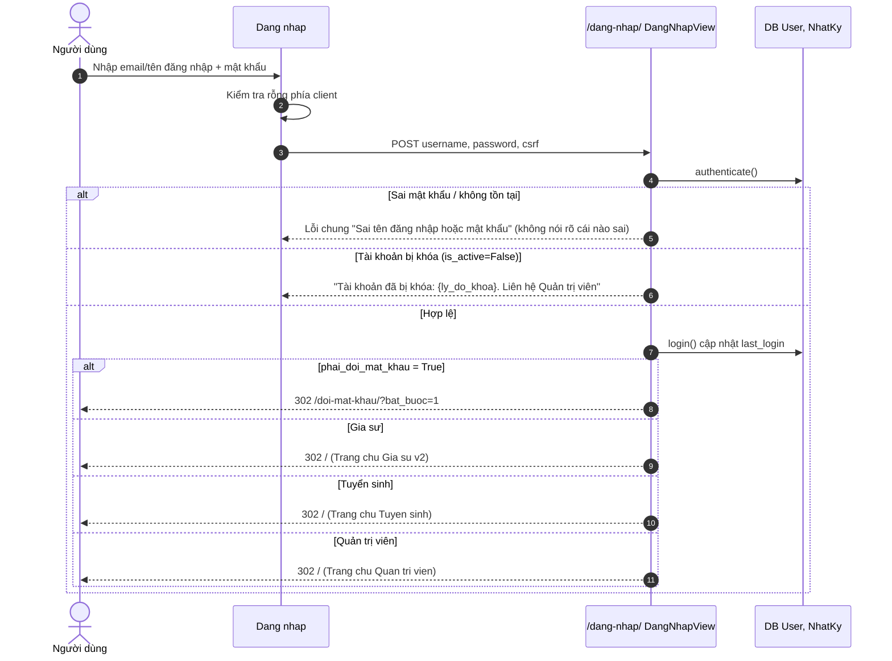
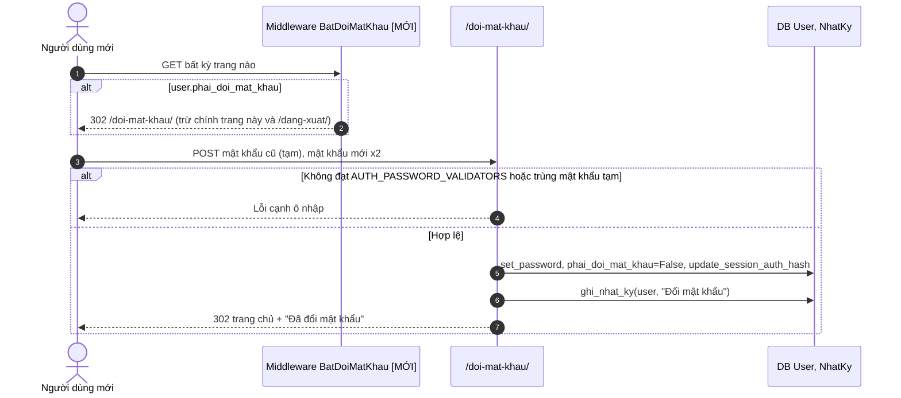
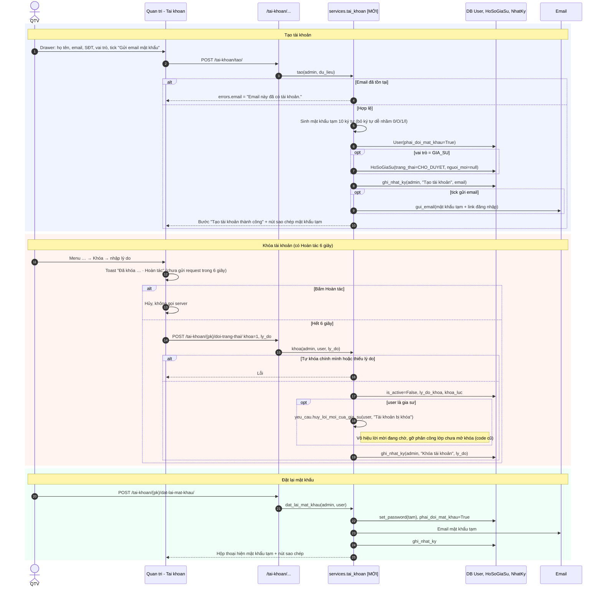
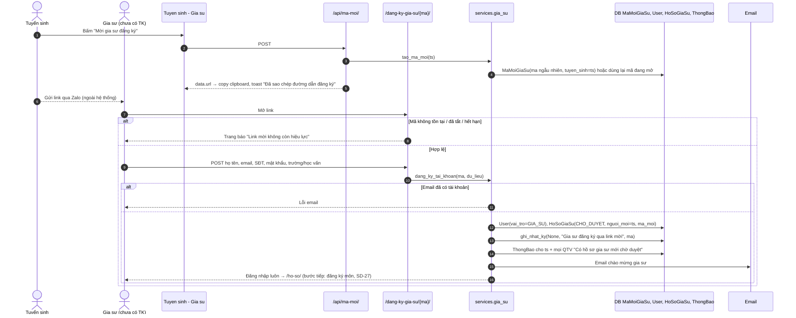

# 10 · Tài khoản, đăng nhập, mời gia sư

## SD-01 · Đăng nhập theo vai trò  [SỬA]

- **Màn hình:** `Dang nhap.dc.html` → trang chủ theo vai trò.
- **Code cũ:** `chung.DangNhapView` (LoginView), `DangNhapForm.clean()`, `ChanTaiKhoanBiKhoaMiddleware`.
- **Thêm:** cờ `phai_doi_mat_khau`, ghi nhật ký đăng nhập thất bại nhiều lần (tùy chọn), thông báo rõ khi tài khoản bị khóa.

| Tình huống | Kết quả |
|---|---|
| Đang đăng nhập thì bị Admin khóa | Request kế tiếp: middleware xóa phiên, về trang đăng nhập với thông báo (đã có) |
| Đã đăng nhập mà mở `/dang-nhap/` | `redirect_authenticated_user` → về trang chủ (đã có) |
| Truy cập trang không đúng vai trò | 403 `templates/403.html` (đã có `vai_tro_required`) |

## SD-02 · Đổi mật khẩu bắt buộc lần đầu  [MỚI]

## SD-03 · Quản trị viên tạo, khóa, đặt lại mật khẩu tài khoản  [SỬA]

- **Màn hình:** `Quan tri - Tai khoan.dc.html` (drawer "Tạo tài khoản", menu "…" mỗi dòng).
- **Code cũ:** `views/tai_khoan.py` (`tao`, `sua`, `doi_trang_thai`), `TaoTaiKhoanForm`. Chưa có service riêng → tạo `services/tai_khoan.py`.

## SD-04 · Tuyển sinh mời gia sư đăng ký qua link  [MỚI]

- **Màn hình:** `Tuyen sinh - Gia su.dc.html` nút "Mời gia sư đăng ký"; trang đăng ký công khai `/dang-ky-gia-su/<ma>/` (cần thêm template, dùng lại khung `Dang nhap`).
- **Ý nghĩa:** gắn `HoSoGiaSu.nguoi_moi` → người này hậu kiểm các buổi của gia sư (SD-21).

| Tình huống | Kết quả |
|---|---|
| Gia sư do Admin tạo tay (SD-03) | `nguoi_moi = null` → Admin gán người phụ trách ở trang Hồ sơ gia sư; trong lúc chưa gán, **mọi Tuyển sinh** thấy buổi của gia sư này ở Hậu kiểm |
| Tuyển sinh nghỉ việc (bị khóa) | Admin chuyển `nguoi_moi` của các gia sư sang người khác (thao tác hàng loạt ở trang Tài khoản, ghi nhật ký) |
