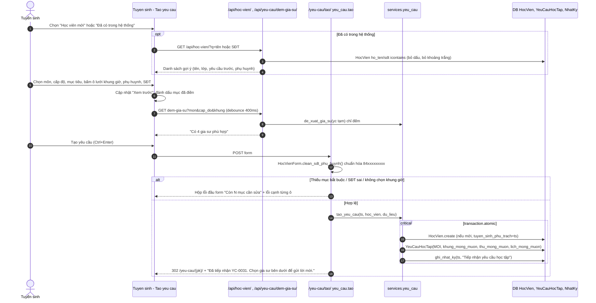
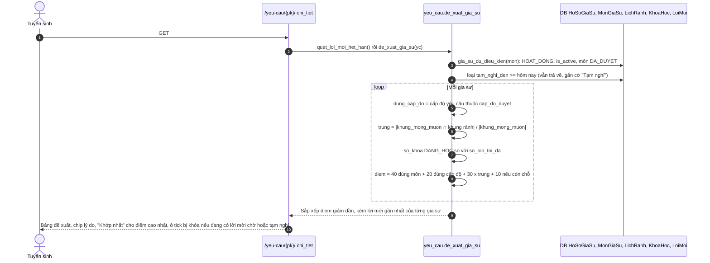
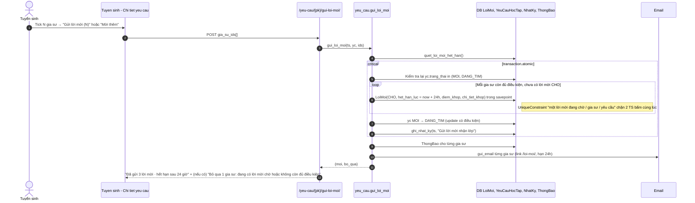
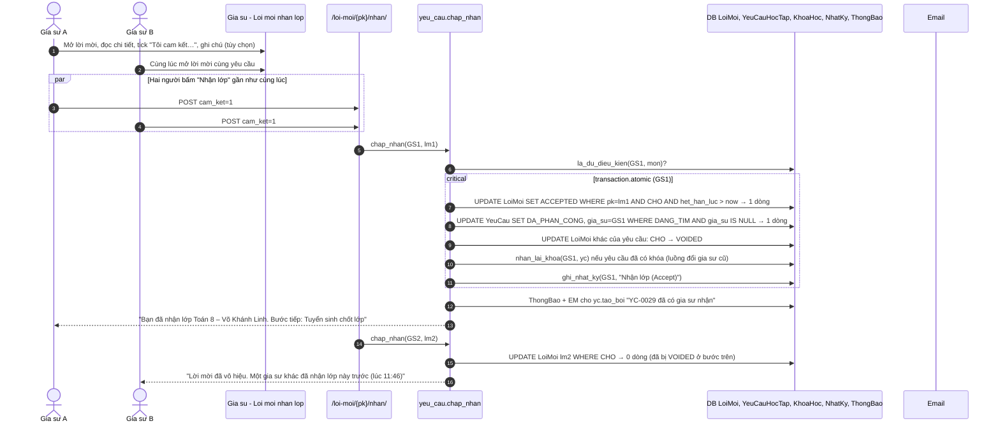
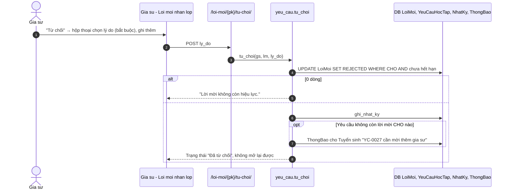
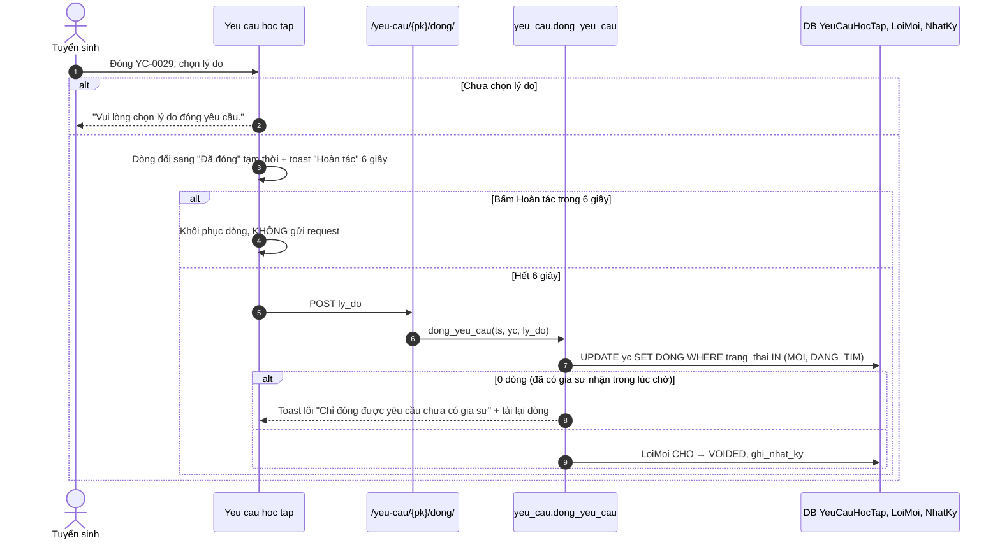

# 11 · Yêu cầu học tập và lời mời nhận lớp

Code cũ: `services/yeu_cau.py` (tiến trình 3.0 trên DFD: 3.1 tiếp nhận, 3.2 đề xuất, 3.3 gửi lời mời, 3.4 xử lý phản hồi).

## SD-05 · Tạo yêu cầu học tập (học viên mới hoặc đã có)  [SỬA]

- **Màn hình:** `Tuyen sinh - Tao yeu cau.dc.html` (form trong khung trắng, khung "Xem trước yêu cầu" bên phải, lưới 7 ngày × 4 khung giờ).
- **Thay đổi:** lưới khung giờ → `khung_mong_muon` (JSON) + tự điền `thu_mong_muon`, `lich_mong_muon`; học viên có `gioi_tinh`, `truong`, `tuyen_sinh_phu_trach`; preview đếm số gia sư phù hợp.

| Tình huống | Kết quả |
|---|---|
| SĐT có `+84`, khoảng trắng | Chuẩn hóa về `84912345678`; hiển thị lại dạng `0912 345 678` |
| Học viên đã có, chọn rồi bấm "Đổi" | Bỏ chọn, quay lại ô tìm |
| Học viên đã có đang có yêu cầu mở cùng môn | Cảnh báo (không chặn): "Võ Khánh Linh đã có YC-0029 môn Toán đang mời gia sư" |

## SD-06 · Đề xuất gia sư có điểm khớp  [SỬA]

- **Màn hình:** `Tuyen sinh - Chi tiet yeu cau.dc.html` – bảng "Gia sư được đề xuất" (điểm 94/86/78…, chip Đúng môn / Đúng cấp độ / Trùng 3/3 giờ / Đang nhận lớp).
- **Code cũ:** `de_xuat_gia_su(yc)` sắp xếp theo số **thứ** trùng, số khóa đang dạy, tên. **Sửa:** tính theo **khung giờ** và trả điểm 0–100.

> Điểm chỉ để **sắp xếp và giải thích** (không AI – PB-05). Lưu lại `diem_khop`, `chi_tiet_khop` vào `LoiMoi` lúc gửi (SD-07) để sau này đối chiếu.

## SD-07 · Gửi lời mời / mời thêm  [SỬA nhỏ]

| Tình huống | Kết quả |
|---|---|
| Không chọn ai | "Hãy chọn ít nhất một gia sư." |
| Yêu cầu vừa được nhận / đóng ở tab khác | "Chỉ gửi lời mời cho yêu cầu đang Mới hoặc Đang mời gia sư." |
| Gia sư vừa bị thu hồi môn | Bị lọc khỏi `hop_le`, đếm vào `bo_qua` |
| Gửi email lỗi | Lời mời vẫn tạo; `NhatKyGuiTin(thanh_cong=False)`; gia sư vẫn thấy chuông + trang Lời mời |

## SD-08 · Gia sư nhận hoặc từ chối lời mời ("Accept hợp lệ đầu tiên thắng")  [SỬA]

- **Màn hình:** `Gia su - Loi moi nhan lop.dc.html` (danh sách bên trái, chi tiết bên phải: đếm ngược, lưới khớp giờ, mục tiêu, ghi chú phụ huynh, thù lao/buổi; nhận lớp phải tick cam kết; từ chối phải chọn lý do).
- **Thêm:** `cam_ket`, `ghi_chu_gia_su`, lý do từ chối bắt buộc; thông báo cho Tuyển sinh; thù lao/buổi lấy từ đâu → **đề xuất** `YeuCauHocTap.thu_lao_du_kien` [MỚI, nhập khi tạo yêu cầu, có thể để trống = "Thỏa thuận khi mở khóa"].

| Tình huống | Kết quả |
|---|---|
| Hết 24h mà chưa phản hồi | `quet_loi_moi_het_han()` → `HET_HAN` (chạy khi mở trang + tác vụ định kỳ); UI đếm ngược chạy về 0 thì tự đổi nhãn "Hết hạn", nút bị khóa |
| Không tick cam kết | Lỗi tại ô tick, không gửi request |
| Gia sư bị thu hồi môn trong lúc lời mời còn chờ | Lời mời đã bị `VOIDED` bởi `huy_loi_moi_cua_gia_su`; nếu còn sót thì `la_du_dieu_kien` chặn: "Bạn chưa đủ điều kiện nhận lớp môn này" |
| Đã kín lịch (`so_khoa ≥ so_lop_toi_da`) | Cảnh báo (không chặn) "Bạn đang dạy 4/4 lớp", lý do từ chối gợi ý "Đã đủ số lớp đang dạy" |

## SD-09 · Đóng yêu cầu (có Hoàn tác)  [SỬA nhỏ]

- **Màn hình:** `Tuyen sinh - Yeu cau hoc tap.dc.html` (menu "…" → Đóng yêu cầu → chọn lý do), `Tuyen sinh - Chi tiet yeu cau.dc.html`.

> Hoàn tác **phía client** (trì hoãn gửi) đơn giản và an toàn hơn "đảo ngược" ở server, vì đóng yêu cầu đã vô hiệu lời mời và không khôi phục được. Áp dụng cùng cách cho khóa tài khoản (SD-03).
