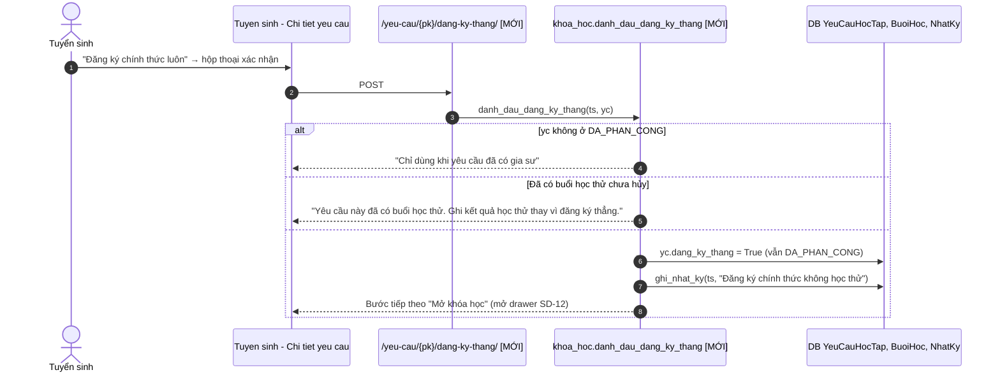
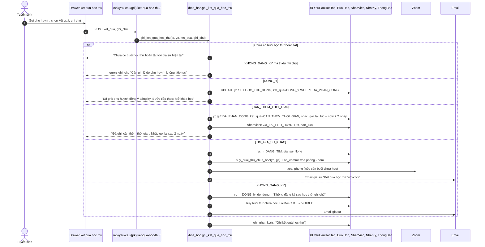
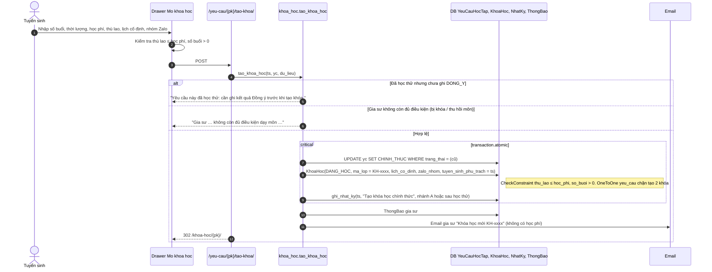

# 12 · Học thử và mở khóa học

Code cũ: `services/khoa_hoc.py` (tiến trình 4.0: 4.1 ghi kết quả học thử, 4.2 tạo khóa). Buổi học thử do **gia sư** tạo (SD-13, `tao_buoi_hoc_thu`).

Dòng tiến trình trên `Tuyen sinh - Chi tiet yeu cau.dc.html`: **Mới → Đang mời gia sư → Đã có gia sư → Học thử → Đã mở khóa**. Ở bước "Đã có gia sư" có 2 lối: chờ gia sư tạo buổi học thử, hoặc **"Đăng ký chính thức luôn"** (nhánh A).

## SD-10 · Đăng ký chính thức luôn (nhánh A, bỏ học thử)  [SỬA]

> Code cũ đã cho tạo khóa thẳng từ `DA_PHAN_CONG` khi chưa có buổi học thử (`co_the_tao_khoa` nhánh A). Cờ `dang_ky_thang` chỉ để UI hiện đúng bước và **chặn gia sư tạo buổi học thử** sau khi đã chốt đăng ký thẳng (`yeu_cau_co_the_hoc_thu` lọc `dang_ky_thang=False`).

## SD-11 · Ghi kết quả học thử (4 kết quả)  [SỬA]

- **Màn hình:** drawer "Ghi kết quả học thử" trên `Trang chu Tuyen sinh` và `Tuyen sinh - Chi tiet yeu cau` (3 thẻ chọn: Đồng ý đăng ký / Không đăng ký / Cần thêm thời gian; thêm lựa chọn phụ "Tìm gia sư khác").
- **Điều kiện:** có buổi học thử `HOAN_TAT` với gia sư hiện tại (`buoi_hoc_thu_hoan_tat`).

| Tình huống | Kết quả |
|---|---|
| `CAN_THEM_THOI_GIAN` rồi gọi lại được | Ghi kết quả lần nữa (cho phép ghi đè khi `ket_qua_hoc_thu = CAN_THEM_THOI_GIAN`); `NhacViec.xong_luc = now` |
| Quá hạn nhắc mà chưa gọi | Tác vụ định kỳ (SD-36) đẩy lên nhóm "Gấp, cần xử lý ngay" trên trang chủ Tuyển sinh |
| Ghi kết quả ở 2 tab | Cập nhật có điều kiện → tab sau báo "Yêu cầu không còn ở trạng thái Đã có gia sư" |

## SD-12 · Mở khóa học chính thức  [SỬA]

- **Màn hình:** drawer "Mở khóa học" (từ `Tuyen sinh - Chi tiet yeu cau`): số buổi, thời lượng 60/90/120, học phí/buổi, thù lao/buổi, **lịch cố định**, **tên nhóm Zalo lớp**, ghi chú phụ huynh.

| Tình huống | Kết quả |
|---|---|
| Bấm "Mở khóa" 2 lần | Lần 2: `IntegrityError` (OneToOne) → "Yêu cầu này đã có khóa học." |
| Thù lao > học phí | Lỗi ô nhập (form) + `CheckConstraint` ở DB |
| Lịch cố định trùng giờ rảnh gia sư? | Chỉ gợi ý; kiểm tra thật khi gia sư tạo buổi (SD-13) |
