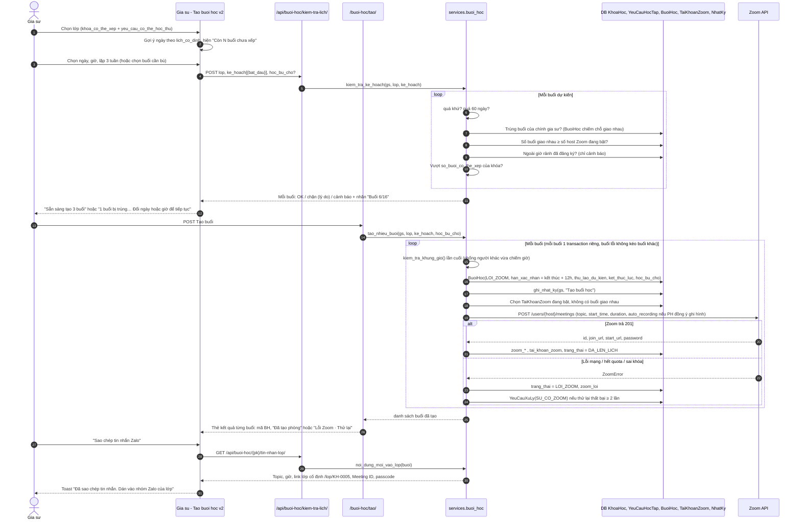
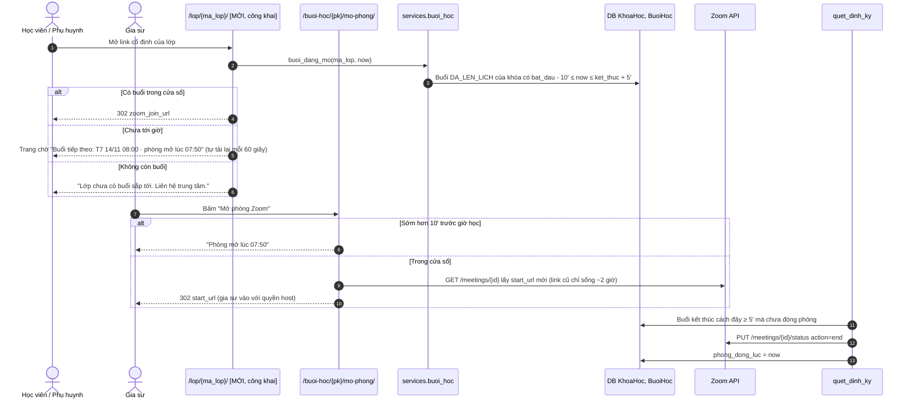
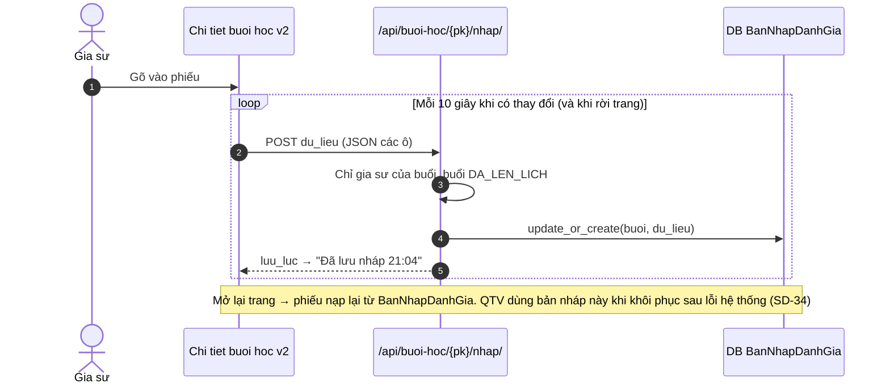
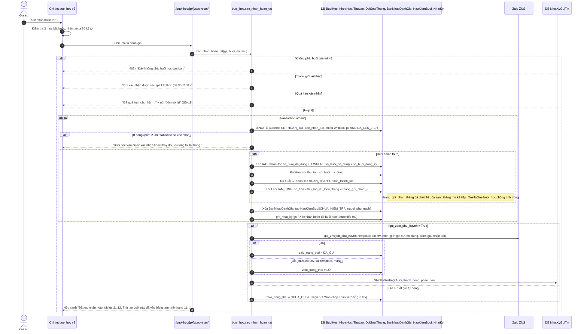
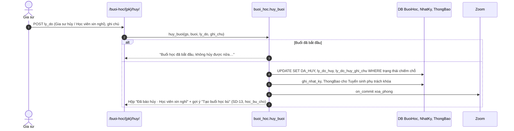
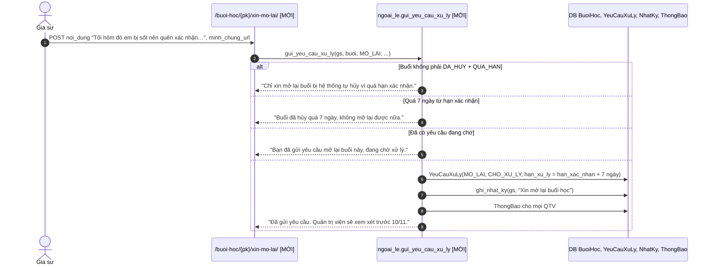

# 13 · Buổi học: tạo → vào lớp → đánh giá → hoàn tất

Code cũ: `services/buoi_hoc.py` (tiến trình 5.0). Ba màn hình gia sư dùng chung một quy trình và cùng khung thông tin buổi (mã buổi, lớp, học viên, ngày giờ, thời lượng, link lớp cố định, Zoom ID, host key, tin nhắn Zalo):

`Gia su - Tao buoi hoc v2` → `Gia su - Chi tiet buoi hoc v2` (đánh giá + xác nhận) → nhật ký buổi học.

## SD-13 · Tạo một hoặc nhiều buổi học + phòng Zoom + tin nhắn Zalo  [SỬA lớn]

- **Màn hình:** `Gia su - Tao buoi hoc v2.dc.html`: chọn lớp (thẻ khóa học có "Lịch cố định T4 20:00 · T7 08:00", tiến độ đã học/đã xếp/còn), chọn ngày trên lịch + giờ, **lặp hằng tuần N buổi**, hoặc **học bù** cho một buổi đã hủy; kiểm tra từng buổi trước khi tạo; sau khi tạo hiện thẻ kết quả từng buổi (Đã tạo phòng / Lỗi Zoom – Thử lại), nút **"Đánh giá buổi học"**, sao chép link lớp, Zoom ID, tin nhắn Zalo.
- **Code cũ:** chỉ tạo 1 buổi (`tao_buoi_chinh_thuc` / `tao_buoi_hoc_thu`). **Thêm** `kiem_tra_ke_hoach()` và `tao_nhieu_buoi()` gọi lại 2 hàm cũ trong vòng lặp.

**Mẫu tin nhắn** (`noi_dung_moi_vao_lop`): `Topic: Buổi dạy KH-0005 - IELTS (Buổi 6/16 · Học bù) của gia sư Phạm Ngọc Lan và học viên Trần Gia Bảo vào 08:00 T7 14/11/2026` · `Vào lớp: https://giasuonline.vn/lop/KH-0005` · `Meeting ID: 845 1209 3377` · `Passcode: ……` · `Phòng mở trước 10 phút.` – **không** chứa host key, học phí, SĐT phụ huynh.

| Tình huống | Kết quả |
|---|---|
| Khóa đã xếp đủ số buổi | Chặn: "Khóa đã xếp đủ số buổi đăng ký" (trừ học bù / dời lịch có `thay_the_cho`) |
| Khóa `TAM_DUNG` / `HUY` | Không hiện trong danh sách lớp; gọi trực tiếp → "Khóa đang ở trạng thái …" |
| Yêu cầu `dang_ky_thang` | Không cho tạo buổi học thử (SD-10) |
| 3 buổi, buổi thứ 2 Zoom lỗi | Buổi 1, 3 `DA_LEN_LICH`; buổi 2 `LOI_ZOOM` có nút Thử lại; nếu tới giờ vẫn lỗi → tự hủy `LOI_ZOOM` (SD-36) |
| Học bù | `hoc_bu_cho` trỏ buổi đã hủy lý do `HOC_VIEN_HUY`/`GIA_SU_HUY`; mỗi buổi hủy chỉ được bù 1 lần (OneToOne) |
| Buổi ngoài giờ rảnh | Cho tạo, cảnh báo vàng "Ngoài giờ rảnh đã đăng ký. Vẫn tạo được, nhớ thống nhất với phụ huynh." |

## SD-14 · Vào lớp: link cố định, mở trước 10′, đóng sau 5′  [MỚI]

- **Màn hình:** khung Zoom trên `Gia su - Chi tiet buoi hoc v2` ("Phòng Zoom đã sẵn sàng", nút "Mở phòng Zoom", host key che `••••••` + nút hiện), trang chủ gia sư "Mở phòng Zoom buổi tiếp theo"; học viên/phụ huynh bấm link cố định `/lop/<ma_lop>/` trong nhóm Zalo.

| Tình huống | Kết quả |
|---|---|
| Gia sư mở bằng tài khoản Zoom cá nhân thay vì link host | Host key giúp gia sư "Claim host"; hậu kiểm nhận diện host qua email tài khoản host (code cũ `_thong_tin_host`) |
| Zoom lỗi khi lấy start_url | Báo "Không lấy được link mở phòng" + nút "Báo sự cố" → `YeuCauXuLy(SU_CO_ZOOM)` |
| Hai lớp chung 1 host liền giờ | Bị chặn từ lúc tạo buổi (SD-13) nên không xảy ra |

## SD-15 · Phiếu đánh giá tự lưu nháp  [MỚI]

- **Màn hình:** `Gia su - Chi tiet buoi hoc v2` – phiếu mở **sau giờ kết thúc**: Nội dung đã dạy* · Mức tiếp thu* (3 thẻ) · Nhận xét gửi phụ huynh* (≥ 30 ký tự) · Bài tập về nhà · Ghi chú cho Tuyển sinh · công tắc "Gửi nhận xét qua Zalo"; đồng hồ "Xác nhận hoàn tất trước 21:30 hôm nay", "Đủ 3/3 mục bắt buộc", "Đã lưu nháp 21:04".

## SD-16 · Xác nhận hoàn tất → số buổi, thù lao, Zalo phụ huynh  [SỬA]

- **Code cũ:** `xac_nhan_hoan_tat()` – giữ toàn bộ logic chống chạy đua; **sửa** form (thêm `muc_tiep_thu`, `bai_tap_ve_nha`, `ghi_chu_tuyen_sinh`, `gui_zalo_phu_huynh`), kiểm tra nhận xét ≥ 30 ký tự, xóa bản nháp, tạo `HauKiemBuoi` (chờ chấm).

| Tình huống | Kết quả |
|---|---|
| Zalo lỗi | **Không** hoàn tác xác nhận; chip "Gửi lỗi" + nút "Gửi lại" (`POST /api/buoi-hoc/{pk}/gui-lai-zalo/`) |
| Khóa đã dùng hết số buổi (dữ liệu lệch) | Rollback cả transaction: "Khóa học đã dùng hết số buổi đăng ký." |
| Tháng của buổi đã chốt đối soát | Thù lao ghi vào tháng mở kế tiếp (code cũ đã có) |
| Lỗi 500 giữa chừng | Transaction rollback; bản nháp còn nguyên; middleware ghi `SuCoHeThong` + tạo `YeuCauXuLy(LOI_HE_THONG)` để QTV khôi phục (SD-34) và **không tính là quá hạn của gia sư** |

## SD-17 · Gia sư báo hủy buổi  [GIỮ + đổi cột ghi chú]

## SD-18 · Dời lịch  [GIỮ]

`doi_lich()` = tạo buổi mới (`thay_the_cho`) **trước**, nếu thành công mới hủy buổi cũ (`DOI_LICH`) trong cùng transaction; phòng Zoom cũ chỉ bị xóa sau commit. Giữ nguyên code; UI gọi từ menu "Dời lịch" trên trang Chi tiết buổi học (chọn ngày giờ mới, dùng lại `kiem-tra-lich` của SD-13).

## SD-19 · Gia sư xin mở lại buổi tự hủy  [MỚI]

- **Màn hình:** `Gia su - Chi tiet buoi hoc v2` trạng thái "Buổi đã tự hủy · Quá hạn xác nhận" → nút "Xin mở lại" (lý do + minh chứng tùy chọn). QTV xử lý ở SD-33.

