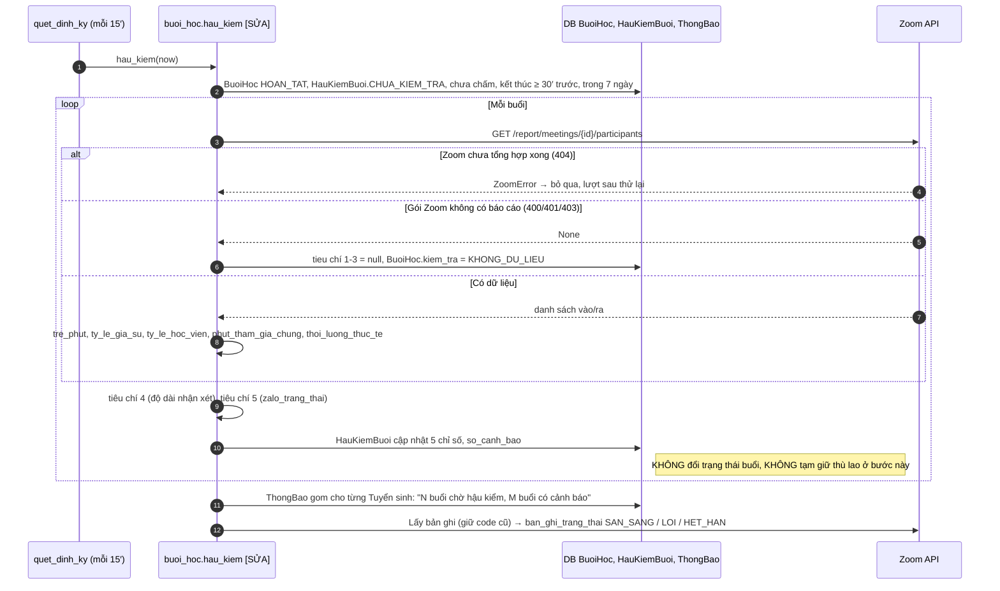
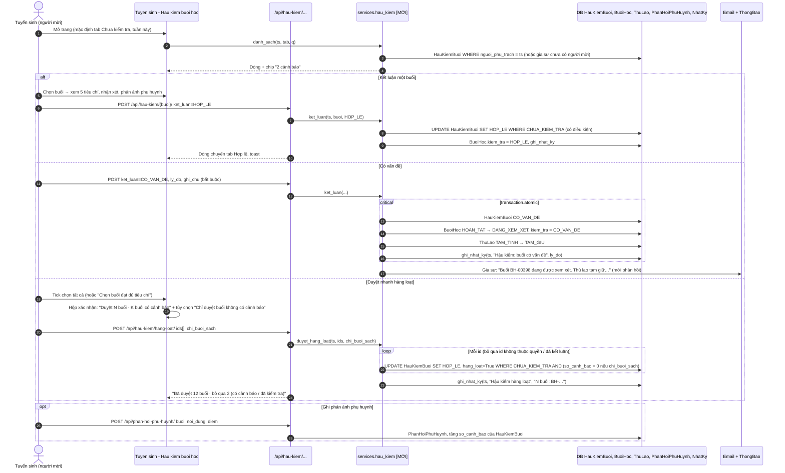
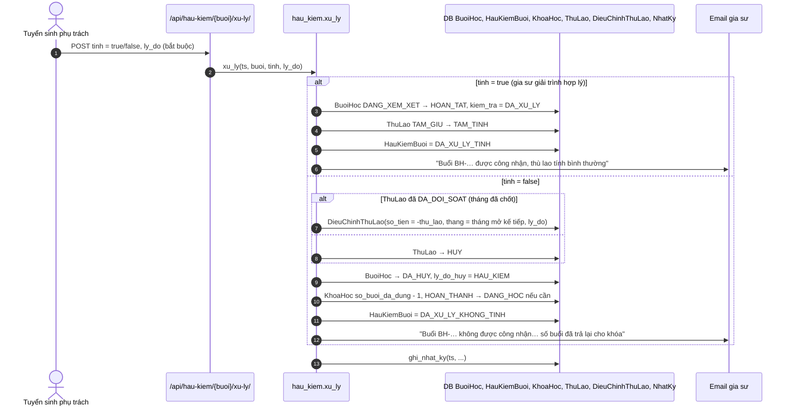

# 14 · Hậu kiểm buổi học

**Thay đổi phân vai (Q1):** code cũ – `hau_kiem()` tự đưa buổi không đạt sang `DANG_XEM_XET` và **Admin** xử lý ở `/xem-xet/`. UI mới – **Tuyển sinh** hậu kiểm buổi của gia sư **do chính mình mời** (`HoSoGiaSu.nguoi_moi`); hệ thống chỉ **thu thập dữ liệu + chấm 5 tiêu chí + gắn cảnh báo**; Admin không làm hậu kiểm.

Nguyên tắc giữ nguyên: **"Xác nhận trước, hậu kiểm sau"** – xác nhận hoàn tất không chờ Zoom; thù lao tạo ngay ở trạng thái Tạm tính.

**5 tiêu chí** (trang `Tuyen sinh - Hau kiem buoi hoc.dc.html`):

| # | Tiêu chí | Nguồn dữ liệu | Ngưỡng (`NGHIEP_VU`) |
|---|---|---|---|
| 1 | Gia sư vào đúng giờ | Zoom participants – lần vào đầu tiên của host so với `bat_dau` | trễ ≤ `TRE_TOI_DA_PHUT` (5) |
| 2 | Gia sư tham gia đủ | tổng phút host có mặt / `thoi_luong_phut` | ≥ `NGUONG_THAM_GIA` (67%) |
| 3 | Học viên tham gia đủ | tổng phút người không phải host | ≥ 67% |
| 4 | Phiếu đánh giá đầy đủ | `len(danh_gia)` | ≥ `DO_DAI_NHAN_XET_TOI_THIEU` (30) |
| 5 | Đã gửi nhận xét qua Zalo | `zalo_trang_thai == DA_GUI` | |

> Code cũ dùng **một** chỉ số "gia sư và học viên **cùng** có mặt" (`danh_gia_tham_gia`). Giữ hàm đó để tính `phut_tham_gia_chung` (vẫn hiện trên Cần xem xét), và tách thêm 3 chỉ số riêng cho UI.

## SD-20 · Hệ thống thu thập dữ liệu Zoom và chấm tiêu chí  [SỬA]

## SD-21 · Tuyển sinh hậu kiểm: từng buổi và duyệt nhanh hàng loạt  [MỚI]

- **Màn hình:** `Tuyen sinh - Hau kiem buoi hoc.dc.html` – thẻ số liệu (buổi tuần này, % hợp lệ, cần chú ý), tab Chưa kiểm tra / Có cảnh báo / Hợp lệ / Có vấn đề / Đã xử lý, ô tìm theo mã buổi, **ô tick chọn tất cả** (trạng thái lửng khi chọn một phần), nút "Chọn buổi đạt đủ tiêu chí", panel chi tiết 5 tiêu chí + nội dung đánh giá + "Phụ huynh phản ánh", nút **Hợp lệ** / **Có vấn đề** (lý do + ghi chú).
- **Quyền:** chỉ buổi có `gia_su.ho_so_gia_su.nguoi_moi = user` (xem `03` mục 5).

| Tình huống | Kết quả |
|---|---|
| Không có dữ liệu Zoom | Tiêu chí 1–3 hiện "Không có dữ liệu", vẫn kết luận được bằng tay |
| Tuyển sinh A mở link buổi của gia sư do B mời | Xem được (đọc), API kết luận trả 403 "Buổi này do Trần Thu Trang phụ trách hậu kiểm" |
| QTV mở trang | Chỉ xem; không có nút kết luận |
| Kết luận ở 2 tab | Cập nhật có điều kiện → tab sau báo "Buổi đã được kiểm tra" |
| Tháng đã **chốt** đối soát mà kết luận Có vấn đề | Thù lao `DA_DOI_SOAT` không chuyển Tạm giữ được → tạo **điều chỉnh trừ** ở tháng sau (SD-22) |

## SD-22 · Xử lý buổi có vấn đề: vẫn tính hoặc không tính  [SỬA – chuyển từ Admin sang Tuyển sinh]

- Dùng lại logic `ngoai_le.xac_nhan_hop_le()` và `ngoai_le.huy_sau_xem_xet()` của code cũ, đổi quyền từ QTV sang Tuyển sinh phụ trách, gắn vào `HauKiemBuoi`.

> Trên UI, tab "Đã xử lý" hiện 2 nhãn: **Đã xử lý** (vẫn tính) và **Không tính**.
