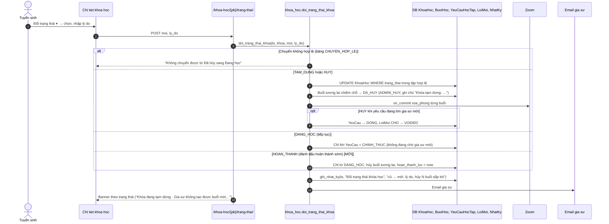
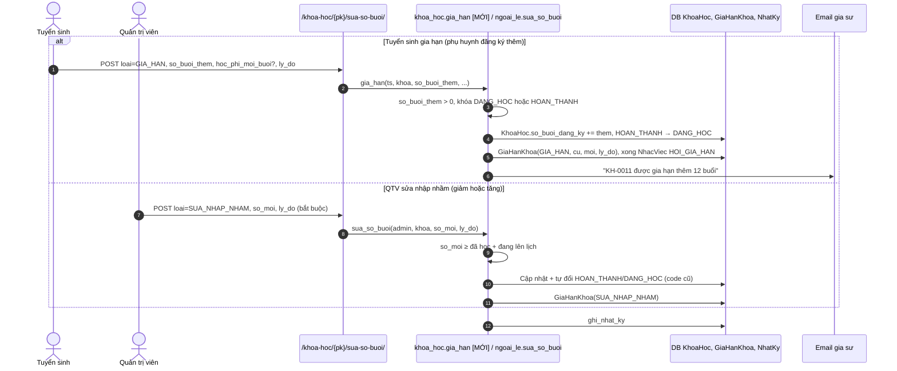
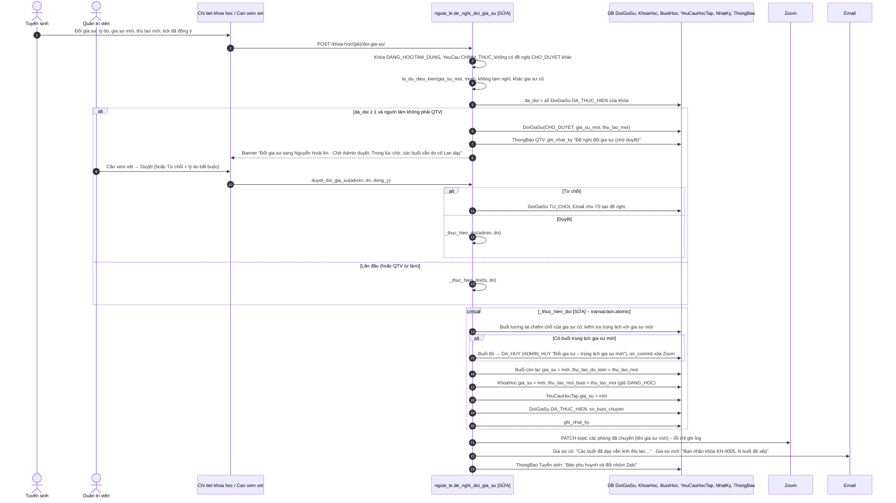

# 15 · Khóa học: trạng thái, gia hạn, đổi gia sư

- **Màn hình:** `Tuyen sinh - Khoa hoc.dc.html` (danh sách + menu "…": Gia hạn thêm buổi, Đề xuất đổi gia sư, Sao chép SĐT phụ huynh) và `Tuyen sinh - Chi tiet khoa hoc.dc.html` (nút Đổi gia sư, Sửa số buổi, Đổi trạng thái ▾; tiến độ đã học / đã xếp / còn lại; danh sách buổi; dòng thời gian).
- **Code cũ:** `khoa_hoc.doi_trang_thai_khoa`, `ngoai_le.sua_so_buoi` (chỉ Admin), `ngoai_le.de_nghi_doi_gia_su / duyet_doi_gia_su / _thuc_hien_doi / nhan_lai_khoa`.

## SD-23 · Đổi trạng thái khóa (tạm dừng, tiếp tục, hoàn thành sớm, hủy)  [SỬA]

| Tình huống | Kết quả |
|---|---|
| Buổi đã dạy nhưng chưa xác nhận khi tạm dừng/hủy | **Không** bị hủy (chỉ hủy `bat_dau > now`), gia sư vẫn xác nhận được |
| Hủy khóa | Không hoàn tác được (UI ghi rõ) |

## SD-24 · Gia hạn thêm buổi (Tuyển sinh) / sửa số buổi nhập nhầm (QTV)  [SỬA]

> Quyền: Tuyển sinh chỉ được **tăng** (gia hạn). Giảm số buổi = sửa dữ liệu đã khóa → chỉ QTV (giữ quy tắc phân vai).

## SD-25 · Đổi gia sư (chọn sẵn gia sư mới, Admin duyệt từ lần 2)  [SỬA lớn – Q2]

- **UI mới** (`Chi tiet khoa hoc` + `Quan tri - Can xem xet` mục "Duyệt đổi gia sư"): Tuyển sinh chọn **lý do**, chọn **gia sư mới** (gợi ý theo khớp khung giờ cố định, đã duyệt môn), **thù lao mới**, tick "Gia sư mới đã đồng ý (qua Zalo)". Khi thực hiện: **các buổi đã xếp lịch chuyển sang gia sư mới**; "Trong lúc chờ duyệt, các buổi vẫn do gia sư cũ dạy".
- **Khác code cũ:** cũ hủy buổi tương lai, tạm dừng khóa, đưa yêu cầu về Đang tìm, chờ ai đó Accept (`nhan_lai_khoa`). Luồng cũ vẫn giữ làm **phương án dự phòng** khi Tuyển sinh chưa tìm được người: chọn "Chưa có gia sư mới – mở lại tìm gia sư".

| Tình huống | Kết quả |
|---|---|
| Buổi đã dạy, chưa xác nhận của gia sư cũ | Không chuyển (chỉ buổi `bat_dau > now`); gia sư cũ vẫn xác nhận và nhận thù lao |
| Thù lao các buổi cũ | Không đổi (đã chụp `thu_lao_du_kien` lúc tạo/hoàn tất) |
| Gia sư mới bị khóa trong lúc chờ duyệt | Duyệt bị chặn: "Gia sư mới không còn đủ điều kiện" → TS tạo đề nghị khác |
| Chọn "Chưa có gia sư mới" | Chạy luồng cũ: hủy buổi tương lai, khóa TAM_DUNG, yêu cầu → DANG_TIM, mời gia sư (SD-07); người Accept nhận lại khóa (`nhan_lai_khoa`) |
