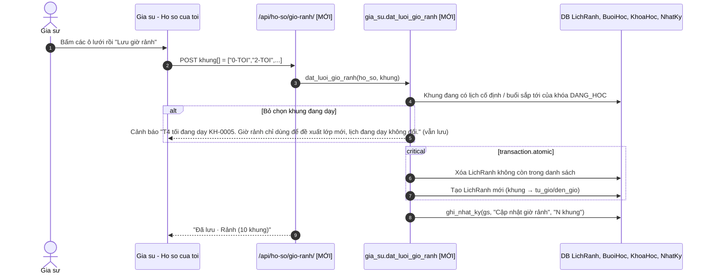
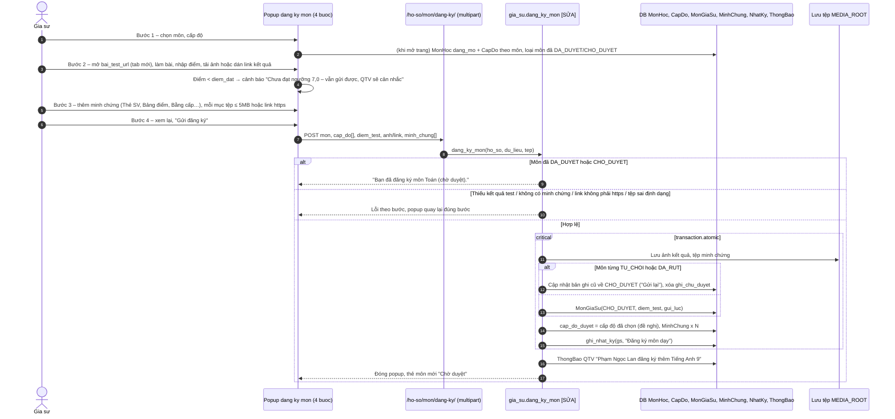
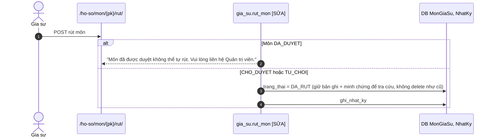
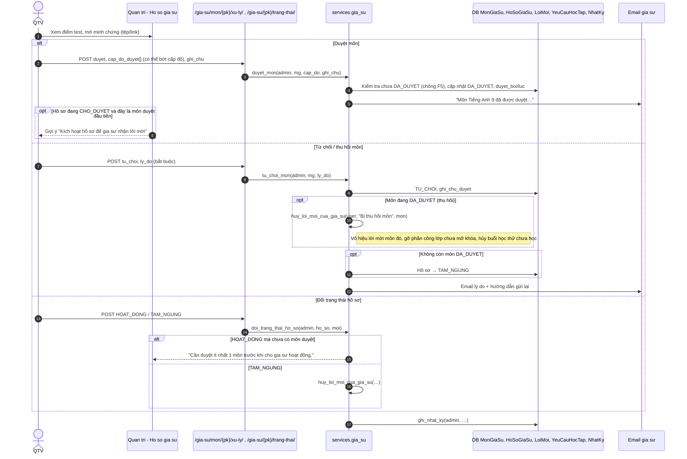

# 16 · Hồ sơ gia sư, giờ rảnh, đăng ký môn

Code cũ: `services/gia_su.py` (tiến trình 2.0 – PB-04, BRULE-09/10). Quy tắc giữ: gia sư **không** sửa/xóa môn đã duyệt; chỉ QTV duyệt/từ chối/thu hồi môn và đổi trạng thái hồ sơ; hồ sơ chỉ "Đang hoạt động" khi có ≥ 1 môn đã duyệt.

## SD-26 · Cập nhật hồ sơ và lưới giờ rảnh  [SỬA]

- **Màn hình:** `Gia su - Ho so cua toi.dc.html` – thông tin cá nhân, học vấn, kinh nghiệm, email Zoom, số lớp tối đa, tạm nghỉ đến ngày; **lưới giờ rảnh** 7 ngày × 4 khung (chú thích "Rảnh (N khung)", ô đang dạy khóa lại).

| Tình huống | Kết quả |
|---|---|
| Đặt "Tạm nghỉ đến 20/11" | Không xuất hiện trong đề xuất (SD-06); lời mời đang chờ → VOIDED qua `huy_loi_moi_cua_gia_su(…, "Gia sư tạm nghỉ")`; buổi đã xếp **không** tự hủy (cảnh báo gia sư tự báo hủy hoặc Tuyển sinh đổi gia sư) |
| Đổi `so_lop_toi_da` thấp hơn số lớp đang dạy | Cho lưu; trạng thái thành "Kín lịch" |

## SD-27 · Đăng ký môn mới – popup 4 bước (bài test + minh chứng)  [SỬA lớn]

- **Màn hình:** popup lớn giữa màn hình trên `Gia su - Ho so cua toi`: **Bước 1** Chọn môn + cấp độ (danh mục do trung tâm cấu hình) → **Bước 2** Làm bài test (link riêng của môn, số câu, thời gian, điểm đạt) → nhập điểm + ảnh/link kết quả → **Bước 3** Minh chứng (nhiều mục: loại + tệp hoặc link https) → **Bước 4** Xem lại và gửi. Danh sách môn có trạng thái Chờ duyệt / Đã duyệt / Bị từ chối (Gửi lại) / Đã rút.

## SD-28 · Quản trị viên duyệt hồ sơ và môn  [SỬA]

- **Màn hình:** `Quan tri - Ho so gia su.dc.html` (thông tin, minh chứng, kết quả test, lưới giờ rảnh, lớp đang dạy) và mục "Hồ sơ & môn" trên `Quan tri - Can xem xet`.

| Tình huống | Kết quả |
|---|---|
| QTV bấm Duyệt 2 lần | Lần 2: "Môn … đã được duyệt rồi." |
| Gán lại Tuyển sinh phụ trách | `POST /gia-su/{pk}/nguoi-phu-trach/` [MỚI] – chỉ QTV, ghi nhật ký; buổi chưa kiểm tra chuyển `HauKiemBuoi.nguoi_phu_trach` sang người mới |
