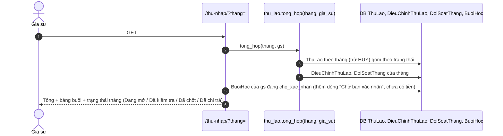
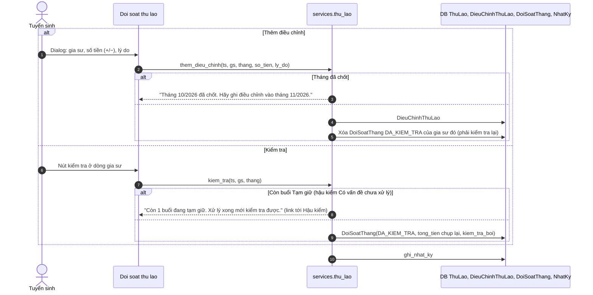
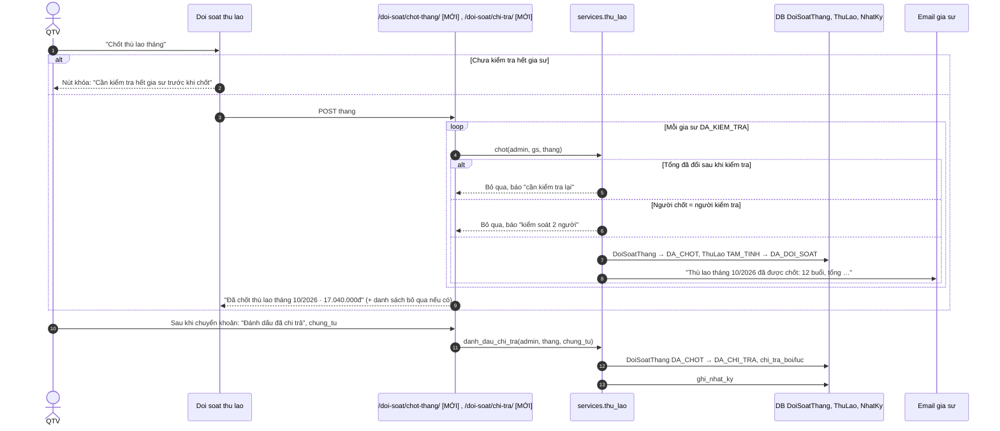

# 17 · Thù lao và đối soát tháng

Code cũ: `services/thu_lao.py` (tiến trình 6.0, PB-16/17, PB-26..28). Giữ nguyên công thức: **Tổng tháng = Tạm tính + Đã đối soát + Điều chỉnh** (Tạm giữ không tính). Kiểm soát 2 người: Tuyển sinh kiểm tra → QTV chốt (người chốt ≠ người kiểm tra). Tháng đã chốt thì khóa sổ, thay đổi sau đó ghi điều chỉnh vào tháng kế tiếp.

Dải 4 bước trên `Quan tri - Doi soat thu lao.dc.html`: **Tự động theo buổi hoàn tất → Tuyển sinh kiểm tra (x/y gia sư) → Quản trị viên chốt → Chi trả cho gia sư**.

## SD-29 · Gia sư xem thu nhập  [SỬA hiển thị]

- **Màn hình:** `Gia su - Thu nhap.dc.html` – chọn tháng, tổng tạm tính/đã đối soát/tạm giữ/điều chỉnh, danh sách buổi với trạng thái Tạm tính · Tạm giữ · Đã đối soát · Đã hủy · **Chờ bạn xác nhận** (buổi đã dạy chưa xác nhận → link tới SD-16).

## SD-30 · Tuyển sinh kiểm tra từng gia sư, thêm điều chỉnh  [GIỮ]

## SD-31 · Quản trị viên chốt tháng và đánh dấu chi trả  [SỬA]

| Tình huống | Kết quả |
|---|---|
| Buổi tháng đã chốt bị hậu kiểm "không tính" | Tạo `DieuChinhThuLao` âm ở tháng mở kế tiếp (SD-22) |
| Gia sư xác nhận buổi tháng 10 vào ngày 01/11 khi tháng 10 đã chốt | `thang_ghi_nhan()` dồn sang tháng 11 (đã có) |
| Xuất CSV | `/doi-soat/csv/` giữ nguyên, thêm cột trạng thái chi trả |
