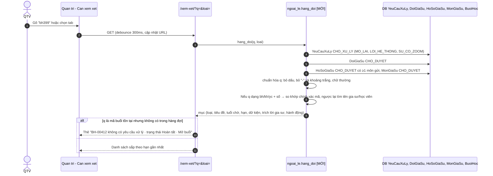
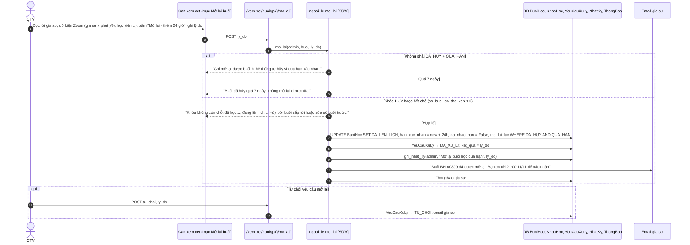
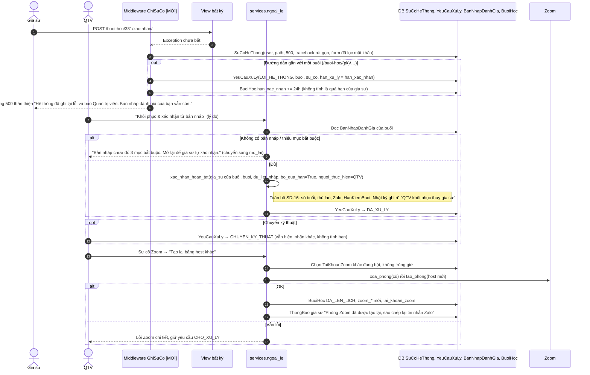
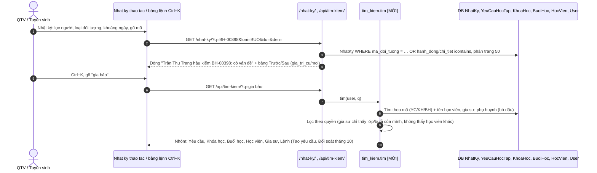

# 18 · Quản trị viên: Cần xem xét, mở lại, sự cố, nhật ký, tìm kiếm

Phạm vi của QTV sau khi đổi phân vai: **quên xác nhận (mở lại buổi tự hủy), lỗi hệ thống, sự cố Zoom, duyệt đổi gia sư lần ≥ 2, duyệt hồ sơ & môn, tài khoản, chốt thù lao**. QTV **không** hậu kiểm buổi học.

## SD-32 · Trang Cần xem xét: hàng đợi hợp nhất + tìm theo mã  [SỬA]

- **Màn hình:** `Quan tri - Can xem xet.dc.html` – tab Tất cả / Mở lại buổi / Lỗi hệ thống / Đổi gia sư / Hồ sơ & môn; ô tìm "Nhập mã buổi BH-00399, mã khóa, tên…" (bỏ dấu, bỏ gạch: `bh00399` = `BH-00399`); nếu mã không nằm trong hàng đợi → thẻ "BH-xxxxx không có yêu cầu xử lý" + link mở buổi.
- **Code cũ:** `ngoai_le.ds_can_xem_xet()` chỉ có buổi `DANG_XEM_XET` + buổi tự hủy trong 7 ngày. **Sửa:** `hang_doi(q, loai)` gộp 5 nguồn.

## SD-33 · Mở lại buổi tự hủy (+24 giờ)  [SỬA]

> Buổi mở lại hiển thị lại "Chờ xác nhận" (vì `ket_thuc ≤ now` và `han_xac_nhan` mới) – đúng với Q4, không cần trạng thái mới.

## SD-34 · Lỗi hệ thống và sự cố Zoom  [MỚI]

- **Màn hình:** mục "Lỗi hệ thống" (VD: "BH-00381 · Gia sư Đỗ Thanh Tùng báo lỗi không xác nhận được · HTTP 500 · /buoi-hoc/381/xac-nhan") với nút **"Khôi phục & xác nhận từ bản nháp"**, **"Chuyển kỹ thuật"**; mục sự cố Zoom với **"Tạo lại bằng host khác"**.

## SD-35 · Nhật ký thao tác và tìm nhanh Ctrl+K  [SỬA]

> Nhật ký **chỉ thêm, không sửa, không xóa**. Không có view sửa/xóa `NhatKy`; trong `admin.py` đặt `has_change_permission/has_delete_permission = False`.
