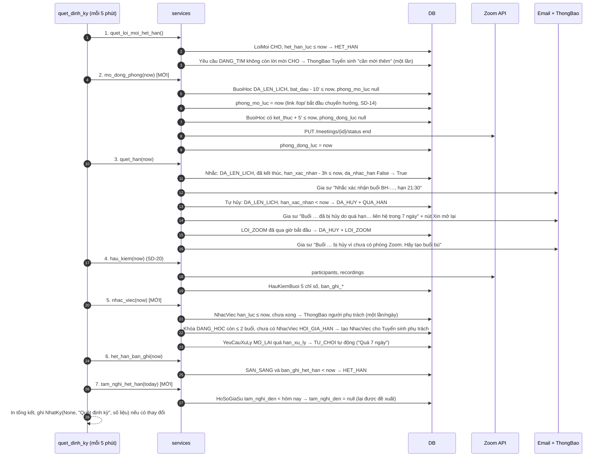

# 19 · Tác vụ định kỳ `quet_dinh_ky`

Code cũ: `management/commands/quet_dinh_ky.py` chạy bằng Windows Task Scheduler mỗi 15 phút: `quet_han()` → `quet_loi_moi_het_han()` → `hau_kiem()`. Ngoài ra `quet_han()` và `quet_loi_moi_het_han()` còn được gọi "lười" khi mở trang chủ/trang lời mời – **giữ cách này** để demo không phụ thuộc lịch chạy.

**Sửa:** chạy mỗi **5 phút** (vì có mở/đóng phòng Zoom theo phút), tách thành các bước độc lập; mỗi bước tự bắt lỗi để một bước lỗi không chặn bước sau; dùng **cập nhật có điều kiện** nên chạy chồng 2 lần cũng không gửi trùng.

## SD-36 · Một lượt quét

## Ma trận thời gian của một buổi học 19:00–20:30

| Mốc | Sự kiện | Ai/cái gì làm |
|---|---|---|
| Lúc tạo buổi | `han_xac_nhan` = 20:30 + 12h = **08:30 hôm sau** | `_tao()` |
| 18:50 | Phòng mở, `/lop/<ma>` chuyển hướng vào Zoom; nút "Mở phòng Zoom" bật | Bước 2 / SD-14 |
| 19:00–20:30 | "Đang học" (hiển thị) | suy ra |
| 20:30 | Phiếu đánh giá mở, "Chờ xác nhận", đồng hồ đếm ngược | suy ra |
| 20:35 | Phòng Zoom bị kết thúc | Bước 2 |
| 05:30 | Email + thông báo nhắc (còn 3h) – "Sắp tự hủy" | Bước 3 |
| 08:30 | Quá hạn → **Tự hủy** (`DA_HUY` + `QUA_HAN`) | Bước 3 |
| ≥ 21:00 sau khi xác nhận | Hậu kiểm lấy dữ liệu Zoom (chờ 30′ Zoom tổng hợp) | Bước 4 |
| Trong 7 ngày | Gia sư xin mở lại → QTV mở lại +24h | SD-19, SD-33 |

## Cấu hình chạy

- Windows (máy demo): Task Scheduler → `python manage.py quet_dinh_ky` mỗi 5 phút.
- Linux/hosting: cron `*/5 * * * * cd /app && python manage.py quet_dinh_ky`.
- Chế độ demo: `THOI_LUONG_BUOI_DEMO=1` (đã có) để chạy trọn luồng trong vài phút.
